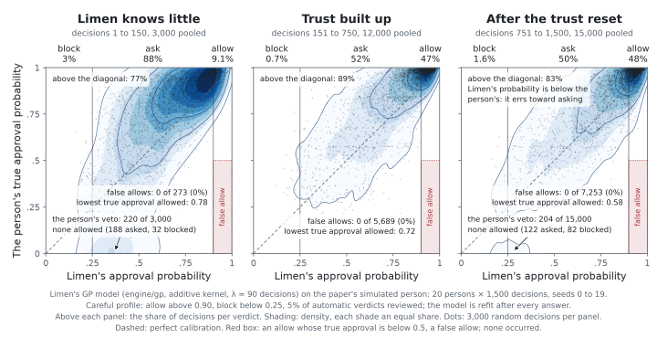
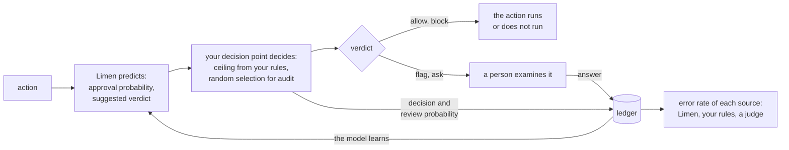

# Limen

[](https://github.com/latere-ai/limen/actions/workflows/verify.yml)
[](https://pkg.go.dev/latere.ai/x/limen)
[](LICENSE)

**Limen learns from the answers of a person which actions of an agent can
run without a question. It also measures how often each automatic decision
is wrong.**

<picture>
  <source media="(prefers-color-scheme: dark)" srcset="docs/figures/teaser-dark.svg">
  
</picture>

*The approval probability that the model of Limen gives, against the true
approval probability of 20 simulated persons, in three parts of 1,500
decisions ([how the figures are made](docs/figures/README.md)).*

An AI agent proposes actions: a shell command, a push, a deploy, a
payment. Before each action runs, a program decides to run it, to ask a
person, or to stop it. These documents call this program the decision
point. Usually the decision point is a list of rules or a second language
model, a judge. A list of rules does not learn that a person approved the
same command one hundred times. And nobody can say how often a judge
allows an action that the person would deny, because the person sees only
the actions that the judge blocked.

Limen gives the decision point a prediction for each action. The
prediction comes from the earlier Allow and Deny answers of the same
person. The thresholds come from the costs that you state. Limen also
records each decision and each answer. From a random share of audits, it
calculates the error rate of each source of decisions: your rules, a
judge, and Limen itself.

Limen is a Go library and a server, `limend`, with an HTTP API. The
method is from the paper
[*Learning When to Ask*](https://arxiv.org/abs/2605.19151).

## Quick start

You need bash, Go 1.27 or later, and `jq` to format the output. Install
and start the server for one person:

```sh
go install latere.ai/x/limen/cmd/limend@latest
export LIMEN_TOKEN=example-token LIMEN_DATA_DIR=$(mktemp -d)
limend > /dev/null &
```

For each action, a decision point makes three calls: it gets a
prediction, it records its decision, and it sends the answer of the
person. The script below makes these calls for eight `publish` actions of
one agent, in two sessions. The person opens the details of each action
and allows it.

```sh
L=http://127.0.0.1:7720
H=(-H "Authorization: Bearer $LIMEN_TOKEN" -H 'Content-Type: application/json')
key() { echo "\"org\":\"local\",\"subject\":\"local\",\"action_id\":\"publish-$1\""; }
predict() { # the action, the session it runs in
  curl -s "${H[@]}" $L/v1/predictions -d "{$(key $1),\"kind\":\"tool\",\"name\":\"publish\",
    \"effect\":\"external\",\"actor\":{\"kind\":\"agent\",\"id\":\"site-builder\",\"session\":\"$2\"}}" |
  jq -c '{action_id, approve: (.approve*1000|round/1000), evidence: (.evidence_ratio*100|round/100),
    verdict, ask_kind, weight: .cover.weight, sessions: .cover.sessions}'
}
for i in 1 2 3 4 5 6 7; do
  s=monday; [ $i -gt 4 ] && s=tuesday
  predict $i $s
  curl -s "${H[@]}" $L/v1/decisions -d "{$(key $i),\"verdict\":\"ask\",\"review_probability\":1,\"source\":\"example\"}" > /dev/null
  curl -s "${H[@]}" $L/v1/answers -d "{$(key $i),\"approve\":true,\"details_opened\":true,\"surface\":\"prompt\"}" > /dev/null
  sleep 2 # Limen fits the model again in the background, approximately one second after an answer
done
predict 8 tuesday
kill %1
```

Limen v0.8.0 gives this output on each computer, because the model has no
random part. A later version can change the numbers:

```
{"action_id":"publish-1","approve":0.5,"evidence":0,"verdict":"ask","ask_kind":"unsure","weight":0,"sessions":0}
{"action_id":"publish-2","approve":0.729,"evidence":0.54,"verdict":"ask","ask_kind":"short","weight":1,"sessions":1}
{"action_id":"publish-3","approve":0.805,"evidence":0.64,"verdict":"ask","ask_kind":"short","weight":2,"sessions":1}
{"action_id":"publish-4","approve":0.845,"evidence":0.69,"verdict":"ask","ask_kind":"short","weight":3,"sessions":1}
{"action_id":"publish-5","approve":0.87,"evidence":0.71,"verdict":"ask","ask_kind":"short","weight":4,"sessions":1}
{"action_id":"publish-6","approve":0.887,"evidence":0.73,"verdict":"ask","ask_kind":"short","weight":5,"sessions":2}
{"action_id":"publish-7","approve":0.899,"evidence":0.74,"verdict":"ask","ask_kind":"short","weight":6,"sessions":2}
{"action_id":"publish-8","approve":0.908,"evidence":0.75,"verdict":"allow","ask_kind":null,"weight":7,"sessions":2}
```

Each allow increases the approval probability, `approve`. With the
default costs, Limen suggests `allow` only if two conditions are true:
the probability is above 0.90, and considered approvals with the same scope
or a wider scope cover the action, with a weight of 3 or more from 2 sessions or more. The
eighth publish is the first action that satisfies the two conditions. If
the person allows each action in less than two seconds without the
details, or if all the answers come in one session, the eighth publish
also gets `ask`, with the `ask_kind` `few`.

## How it works



- **Predict.** Limen calculates the probability that the person approves
  the action, and the uncertainty of this probability. It suggests a
  verdict: `allow`, `ask`, or `block`.
- **Decide.** Your decision point decides, not Limen. It uses one shared
  function, `verdict.Decide`, with three inputs: the suggested verdict,
  the ceiling from your rules, and a random selection for audit.
- **Keep the ledger.** Limen keeps each decision and each answer. The
  model learns from the answers. Because each decision records the
  probability that a person saw the action, Limen can calculate the error
  rate of each source without bias. A decision point that decides only
  with rules can use the ledger to measure its rules and its judge.

Each implementation of Limen obeys these rules:

- **An unclear action waits for a person.** If the evidence is not clear,
  Limen suggests `ask`, not `block`. If Limen fails or does not answer in
  time, the suggested verdict is `ask`. A failure never allows an action.
- **The costs set the thresholds.** You state the cost of a false allow,
  of a false block, and of one question. A formula calculates the two
  thresholds from these costs. Nobody adjusts the thresholds by hand.
- **No allow beyond what the person allowed.** Limen reads the scope of
  each action: if it can be undone, which boundaries it crosses, and the
  class of its target. An approval of a push to a feature branch does not
  cover a push to `main` that cannot be undone. That push gets `ask`, with
  the `ask_kind` `wider`.
- **A quick approval is not consent.** An approval from a rule has the
  weight 0. An approval in less than two seconds, from one gesture for
  many actions, after a shown approval probability above 0.5, or late in
  a long session, has the weight 0 if the person did not open the
  details. It teaches the model, but it does not let an
  action run without a question.
- **A number only where the audits support it.** The calibration report
  compares the probabilities that Limen stated with the approval rates
  that the reviews of the person measured. A client shows a probability or
  a recommendation only where the report says `calibrated`. Above the
  upper threshold, the certificate from the audits must also hold.
- **Your rules have priority.** The ceiling from your rules is a limit for
  the suggested verdict.
- **Tolerance changes, risk does not.** The model lets the tolerance of a
  person change with time. It does not let the risk of an action change
  with time.

[Principles](docs/principles.md) gives each rule and its reason.
[Theory](docs/theory.md) gives the mathematics.

## Use Limen from Go

The engine can run in the process of your decision point, or you can call
`limend` with the HTTP client. The two are a `limen.Service`.

```go
svc, err := client.New("http://127.0.0.1:7720", client.Options{HTTP: http.DefaultClient, Token: token})
if err != nil {
	log.Fatal(err)
}
// If Limen fails or is slow, the prediction is ask. It is never allow.
predictor := limen.FailClosed(svc, 200*time.Millisecond, func(err error) { log.Print(err) })

a := limen.Action{
	Key:         limen.Key{Org: "org_7", Subject: "usr_42", ActionID: "ses_9f/toolu_01"},
	Actor:       &limen.Actor{Kind: "agent", ID: "agt_ci", Session: "ses_9f"},
	Kind:        "tool",
	Name:        "bash",
	Effect:      limen.EffectExternal,
	Input:       json.RawMessage(`{"command":"git push origin main"}`),
	Target:      &limen.Target{Kind: "ref", ID: "refs/heads/main"},
	Environment: &limen.Environment{Kind: "sandbox", Credentialed: true},
}
p, _ := predictor.Predict(ctx, a)

// Your rules give the ceiling. The random selection for audit occurs here, one time for each action.
v, prob := verdict.Decide(p.Verdict, ceiling(a), p.AuditRate, rand.Float64())

d := limen.Decision{Key: a.Key, Verdict: v, ReviewProbability: prob, Source: "myharness/learned"}
if p.Source == limen.SourceUnavailable {
	d.Action = &a // Limen has no record of this action.
}
if err := svc.Record(ctx, d); err != nil {
	log.Print(err)
}

switch v {
case limen.Allow:
	run()
case limen.Flag:
	run()
	queueForReview(a.Key) // A person examines the action later.
case limen.Ask:
	svc.Answer(ctx, limen.Answer{Key: a.Key, Approve: holdForPerson()})
case limen.Block:
	refuse()
}
```

The packages are `latere.ai/x/limen`, `latere.ai/x/limen/client`, and
`latere.ai/x/pkg/verdict`. [Integration](docs/integrating.md) tells which
fields to send, how to send the way that a person answered, and how to
start safely. [API](docs/api.md) gives each HTTP route.

## Use Limen with Topos

[Topos](https://github.com/latere-ai/topos) v0.69.0 or later sends each
tool call of a session to Limen, with the scope of the call and the way
that the person answered. Start `limend` with a secret token, and give
Topos the address and the token:

```sh
export LIMEN_TOKEN=$(openssl rand -hex 16)
limend &
export TOPOS_DECISIONS_URL=http://127.0.0.1:7720 TOPOS_DECISIONS_TOKEN=$LIMEN_TOKEN
```

In `manual` mode, the rules of Topos decide, and Limen learns from each
answer. In `auto` mode, the suggested verdict of Limen decides the calls
that the rules do not decide, and never above the ceiling from the rules.

```sh
topos run --mode manual "..."
topos run --mode auto "..."
```

[Integration](docs/integrating.md#topos-on-your-computer) gives the
details.

## Replay recorded decisions

A replay shows what Limen would suggest for decisions that you already
made. It does not change what your agent does. To replay the sessions in
a [Topos](https://github.com/latere-ai/topos) data directory, run this
command from a checkout of this repository:

```sh
go run ./cmd/limen replay topos
```

`limen compare` runs the two model versions, `learned/1` and `learned/2`,
on the same records, before you choose one with `LIMEN_MODEL`.

## Documentation

| Page | Contents |
|---|---|
| [Integration](docs/integrating.md) | For authors of a decision point: the three calls, actions, your rules, answers, explanations, a safe start, and notes for each agent harness |
| [API](docs/api.md) | Each HTTP route, its request, its response, its errors, and the permission that it needs |
| [OpenAPI](api/openapi.yaml) | The HTTP API as an OpenAPI 3.1 document |
| [Running limend](docs/running.md) | The configuration of the server, for one person or hosted, and how to run it in a container |
| [The ledger](docs/ledger.md) | What Limen records, the review probability, and how Limen calculates the error rate of each source |
| [Principles](docs/principles.md) | The rules that each implementation obeys, and their reasons |
| [Theory](docs/theory.md) | The model, the decision rule, forgetting, the estimates, and the calibration report |
| [Terms](docs/terms.md) | The meaning of each term in these documents |
| [Specs](specs/README.md) | The design records, for contributors |

## Research

Limen uses the method of the paper *Learning When to Ask: Trust
Calibration for Agentic Tool Use, from Known Tools to Opaque LLM Judges*
([arXiv:2605.19151](https://arxiv.org/abs/2605.19151)). The simulations, a
reference implementation, and machine-checked proofs of the eight
propositions of the paper are at
[github.com/changkun/trustcalib](https://github.com/changkun/trustcalib).

```bibtex
@misc{ou2026learning,
  title         = {Learning When to Ask: Trust Calibration for Agentic Tool
                   Use, from Known Tools to Opaque LLM Judges},
  author        = {Ou, Changkun},
  year          = {2026},
  eprint        = {2605.19151},
  archivePrefix = {arXiv},
  primaryClass  = {cs.AI},
  url           = {https://arxiv.org/abs/2605.19151}
}
```

## Contributing

[`CONTRIBUTING.md`](CONTRIBUTING.md) tells how to build and test Limen and
how to send a change. To report a vulnerability, follow
[`SECURITY.md`](SECURITY.md).

## License

Apache License 2.0. See [`LICENSE`](LICENSE).
