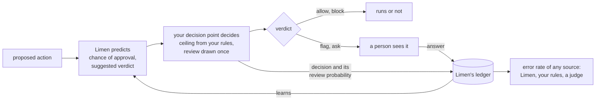

# Limen

**The oversight layer for automated actions: which actions may run on
their own, which a person should see, and how often each source of those
decisions is wrong.**

Agents propose actions: a shell command, a merge, a network request, a
deploy, a payment. Something decides whether each one runs. Limen learns,
from each person's own approve and deny answers, when an action needs
them; it derives its suggestions from what your organization says errors
and interruptions cost; and it keeps a ledger of every decision, with the
probability that a person saw the action, which makes the error rate of
any decision source measurable: your rules, an LLM judge, Limen itself.

> **Status: pre-release.** Built: the contract (the Go types and
> interfaces, the HTTP API, the error codes); the engine, which predicts
> with the Gaussian-process model ported from the research code, keeps the
> ledger in memory or in a directory, and refits off the decision path; the
> HTTP server and client; the `limen` command, which serves the API for one
> person (`limen serve`) and replays recorded history (`limen replay`),
> including a Topos data directory; an in-memory stub and the conformance
> suite every implementation passes. Not built yet: a Postgres store for a
> hosted installation, and hooks for Claude Code and Codex, which
> [`specs/`](specs/README.md) describes. Limen has not yet decided a live
> action for anyone; start with a replay.

## The problem

Agent harnesses gate actions with a switch: run it, or refuse it. A
refusal does not pause the run for a person. The agent reads it as a
result and keeps going, often by routing around the obstacle in ways that
are worse than asking would have been.

Where a harness can ask, when to ask is usually a hand-written list or a
threshold someone tuned once. It does not learn that a person has approved
the same test command a hundred times, and it does not notice when that
person moves to an unfamiliar production system and becomes stricter.

Harnesses that route everything through a shell have no fixed list of
tools to write rules against, so they hand the decision to a second
language model, a judge. The judge is opaque. Nobody can say how often it
allows what a given person would deny, and in current designs the person
only sees what the judge blocked, so its wrong allows are never observed.

The same questions come back wherever software acts on someone's behalf: a
sandbox reaching the network, a push to a protected branch, an agent
spending money.

## How it works

Three parts, each usable on its own:



- **Predict.** For the person on whose behalf an action runs, Limen
  predicts the probability that they would approve it, says how uncertain
  that is, and suggests allow, ask, or block.
- **Decide.** Your decision point decides, not Limen. It composes the
  suggestion with the ceiling its own rules leave open and with a random
  review of a small share of automatic verdicts, using one shared function,
  and records what it did.
- **Ledger.** Limen keeps every decision and every answer, learns from
  them, and reports how often any source of decisions allows what the
  person would deny. A harness that decides by rules alone can use the
  ledger without the predictor, to learn how often its rules and its judge
  are wrong.

What that buys, in rules every implementation keeps:

- **Escalate, don't refuse.** When the evidence is unclear, the action
  waits for a person instead of failing.
- **Thresholds come from costs.** You state what a wrong allow, a wrong
  block, and one interruption cost; the thresholds follow by a closed
  formula. Nobody tunes them, and an action about someone Limen knows
  nothing about is always an ask.
- **Your rules win.** Your deterministic rules set a ceiling Limen's
  suggestion cannot exceed, and when Limen fails or times out, the action
  waits for a person.
- **Learn the person, keep the risk.** A Gaussian-process model lets each
  person's tolerance drift, but keeps what it learned about how risky each
  kind of action is.
- **Know every source's error rate.** Each decision is recorded with the
  probability that a person saw the action, so each answer counts with the
  right weight and error rates come out unbiased, for Limen, for your
  rules, and for any judge whose verdict you pass in.

[Principles](docs/principles.md) states each rule and why it holds;
[Theory](docs/theory.md) is the mathematics in brief.

## At a glance

A decision point predicts, decides, records, and later sends the answer.
In Go:

```go
import (
	"math/rand/v2"

	"latere.ai/x/limen"
	"latere.ai/x/pkg/verdict"
)

// svc is Limen: the in-process engine, or the HTTP client.
predictor := limen.FailClosed(svc, 200*time.Millisecond, func(err error) { log.Print(err) })

a := limen.Action{
	Key:         limen.Key{Org: "org_7", Subject: "https://issuer.example|usr_42", ActionID: "ses_9f/toolu_01"},
	Actor:       &limen.Actor{Kind: "agent", ID: "agt_ci", Session: "ses_9f"},
	Kind:        "tool",
	Name:        "bash",
	Effect:      limen.EffectExternal,
	Input:       json.RawMessage(`{"command":"git push origin main"}`),
	Target:      &limen.Target{Kind: "ref", ID: "refs/heads/main"},
	Environment: &limen.Environment{Kind: "sandbox", Credentialed: true},
	Signals:     []limen.Signal{{Source: "classifier/claude-auto-mode", Verdict: limen.Allow}},
}

// Never an error: a failure comes back as an ask.
p, _ := predictor.Predict(ctx, a)

// Your rules set the ceiling. The review is drawn once, here, for this action.
v, prob := verdict.Decide(p.Verdict, ceiling(a), p.AuditRate, rand.Float64())

d := limen.Decision{Key: a.Key, Verdict: v, ReviewProbability: prob, Source: "myharness/learned"}
if p.Source == limen.SourceUnavailable {
	d.Action = &a // Limen holds no record of this action yet
}
svc.Record(ctx, d)

switch v {
case limen.Allow:
	run()
case limen.Flag:
	run()
	queueForReview(a.Key) // the person answers later
case limen.Ask:
	svc.Answer(ctx, limen.Answer{Key: a.Key, Approve: holdForPerson()})
case limen.Block:
	refuse() // with your own words, never Limen's reason
}
```

The same over HTTP:

```http
POST /v1/predictions
Authorization: Bearer <token>
Content-Type: application/json

{
  "org": "org_7",
  "subject": "https://issuer.example|usr_42",
  "action_id": "ses_9f/toolu_01",
  "actor": {"kind": "agent", "id": "agt_ci", "session": "ses_9f"},
  "kind": "tool",
  "name": "bash",
  "effect": "external",
  "input": {"command": "git push origin main"},
  "target": {"kind": "ref", "id": "refs/heads/main"},
  "environment": {"kind": "sandbox", "credentialed": true},
  "signals": [{"source": "classifier/claude-auto-mode", "verdict": "allow"}]
}
```

```json
{
  "org": "org_7",
  "subject": "https://issuer.example|usr_42",
  "action_id": "ses_9f/toolu_01",
  "verdict": "ask",
  "approve": 0.58,
  "uncertainty": 0.71,
  "thresholds": {"allow_above": 0.9, "block_below": 0.25},
  "profile": {"org": "org_7"},
  "audit_rate": 0.05,
  "source": "learned/3",
  "reason": "The chance this person approves (0.58) is inside the ask band (0.25 to 0.90)."
}
```

The judge said allow, but Limen does not know this person approves a push
to `main` often enough to skip asking under these costs. Your decision
point asks, and records it:

```http
POST /v1/decisions

{"org": "org_7", "subject": "https://issuer.example|usr_42", "action_id": "ses_9f/toolu_01",
 "verdict": "ask", "review_probability": 1, "source": "myharness/learned"}
```

When the person answers, `POST /v1/answers` with the same key and
`"approve": true`. A month later, `GET /v1/reliability?...&of=classifier/claude-auto-mode`
says how often that judge allowed what this person would have denied.

## Try it

Replay what a decision point already recorded, to see what Limen would
have suggested. From a Topos data directory:

```sh
go run ./cmd/limen replay topos
```

Serve the API for yourself, with the ledger on disk, and point Topos at
it. Manual mode teaches Limen from your answers; auto mode lets its
suggestions decide inside Topos's rules:

```sh
export LIMEN_TOKEN=$(openssl rand -hex 16)
go run ./cmd/limen serve &          # http://127.0.0.1:7720

export TOPOS_DECISIONS_URL=http://127.0.0.1:7720 TOPOS_DECISIONS_TOKEN=$LIMEN_TOKEN
topos run --mode manual "..."       # every call asks; each answer teaches Limen
topos run --mode auto   "..."       # Limen decides inside the rules, and asks when unsure
```

[Integrating](docs/integrating.md#notes-by-harness) has the details.

## Documentation

| Page | |
|---|---|
| [Integrating](docs/integrating.md) | for decision-point authors: the three calls, actions from several domains, composing with your rules, recording, answers, rolling out, notes for Topos, Claude Code, and Codex |
| [The ledger](docs/ledger.md) | what is recorded, what a review probability means, and how the error rate of any source is computed |
| [API](docs/api.md) | every HTTP route, its request and response, the errors, and the permission each asks |
| [OpenAPI](api/openapi.yaml) | the same surface as an OpenAPI 3.1 document |
| [Principles](docs/principles.md) | the rules every implementation keeps, and why |
| [Theory](docs/theory.md) | the model, the decision rule, forgetting, the estimators, and what can be known about a judge |
| [Specs](specs/README.md) | the design records the implementation is built from |

The Go reference is the package documentation of `latere.ai/x/limen` and
`latere.ai/x/pkg/verdict`.

## Research

Limen is built on the paper *Learning When to Ask: Trust Calibration for
Agentic Tool Use, from Known Tools to Opaque LLM Judges*
([arXiv:2605.19151](https://arxiv.org/abs/2605.19151)). Its simulations,
a reference implementation, and machine-checked proofs of its eight
propositions are at
[github.com/changkun/trustcalib](https://github.com/changkun/trustcalib).

```bibtex
@misc{ou2026learning,
  title         = {Learning When to Ask: Trust Calibration for Agentic Tool
                   Use, from Known Tools to Opaque LLM Judges},
  author        = {Ou, Changkun},
  year          = {2026},
  eprint        = {2605.19151},
  archivePrefix = {arXiv},
  primaryClass  = {cs.AI},
  url           = {https://arxiv.org/abs/2605.19151}
}
```

## Contributing

[`CONTRIBUTING.md`](CONTRIBUTING.md) is how to build, test, and send a
change. Report a vulnerability as [`SECURITY.md`](SECURITY.md) describes.

## License

Apache License 2.0. See [`LICENSE`](LICENSE).
