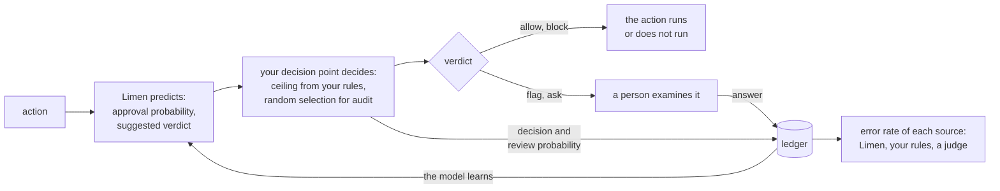

# Limen

**Limen learns which automated actions a person approves. It also measures
how often each automatic decision is wrong.**

An AI agent proposes actions, for example a shell command, a merge, a
network request, a deploy, or a payment. Before each action runs, a
program must decide: run the action, ask a person, or stop the action. In
these documents, this program is the decision point.

Limen gives the decision point a prediction for each action. The
prediction comes from the earlier answers of the same person. The
thresholds of the prediction come from the costs that your organization
states. Limen also records each decision and each answer. From these
records, Limen calculates the error rate of each source of decisions: your
rules, a language model that examines actions, and Limen itself.

> **Status: pre-release.** Limen has not decided a live action for a
> person yet. Start with a [replay](#replay-recorded-decisions) of
> recorded decisions.
>
> These parts are ready:
>
> - The contract: the Go types and interfaces, the HTTP API, and the error
>   codes.
> - The engine. It predicts with the Gaussian-process model from the
>   research code. It keeps the ledger in memory or in a directory. It
>   updates the models in the background, not while a decision waits.
> - The server, `limend`, and its HTTP client. The server supplies the API
>   for one person and keeps the ledger on disk.
> - The `limen` command. It replays recorded decisions, for example from a
>   Topos data directory.
> - A stub service for tests, and the conformance tests that each
>   implementation must pass.
>
> These parts are not ready: a store for a hosted installation, and hooks
> for Claude Code and Codex. The [specs](specs/README.md) describe them.

## The problem

Agent harnesses usually have two choices for an action: run it, or refuse
it. A refusal does not stop the agent to wait for a person. The agent reads
the refusal as a result and continues. Frequently, the agent then tries a
different action that is worse than a question to the person.

Some agent harnesses can ask the person. But the decision to ask usually
comes from a fixed list, or from a threshold that somebody set one time.
The list does not learn. It does not see that a person approved the same
test command one hundred times. It does not see that the same person is
more careful on an unfamiliar production system.

Some agent harnesses send all actions through a shell. They have no fixed
list of tools to write rules for. Instead, they give the decision to a
second language model, a judge.

Nobody can see how the judge decides. Nobody can say how often the judge
allows an action that a given person would deny. In current designs, the
person sees only the actions that the judge blocked. Because of this, the
person never sees the false allows of the judge.

The same problem occurs in other places where software acts for a person.
Examples are a sandbox that connects to the network, a push to a protected
branch, and an agent that spends money.

## How it works

Limen has three parts. You can use each part alone.



- **Predict.** Limen calculates the probability that the person approves
  the action. It gives the uncertainty of this probability. It suggests a
  verdict: `allow`, `ask`, or `block`.
- **Decide.** Your decision point decides, not Limen. It uses one shared
  function, `verdict.Decide`, with three inputs: the suggested verdict, the
  ceiling from your rules, and a random selection for audit. Then the
  decision point records the decision.
- **Keep the ledger.** Limen keeps each decision and each answer. The model
  learns from the answers. Limen reports how often each source allows an
  action that the person would deny. A decision point that decides only
  with rules can use the ledger without the predictions. It can then
  measure the error rate of its rules and of its judge.

These rules apply to each implementation of Limen:

- **An unclear action waits for a person.** If the evidence is not clear,
  the action waits for a person. It does not fail.
- **The costs set the thresholds.** You state three costs: the cost of a
  false allow, the cost of a false block, and the cost of one `ask`. A
  formula calculates the thresholds from these costs. Nobody adjusts the
  thresholds by hand. If Limen has no answers from a person, it suggests
  `ask`.
- **Your rules have priority.** The ceiling from your rules is a limit for
  the suggested verdict. If Limen fails or does not answer in time, the
  action waits for a person.
- **Tolerance changes, risk does not.** The model lets the tolerance of
  each person change with time. It does not let the risk of an action
  change with time.
- **Each source has a known error rate.** Each decision includes the
  probability that a person saw the action. Limen uses this probability to
  give each answer the correct weight. The result is error rates without
  bias, for Limen, for your rules, and for each judge whose verdict you
  supply.

[Principles](docs/principles.md) gives each rule and the reason for it.
[Theory](docs/theory.md) gives the mathematics. [Terms](docs/terms.md)
gives the meaning of each term.

## Example

For each action, a decision point does these steps:

1. It gets a prediction from Limen.
2. It decides with `verdict.Decide`.
3. It records the decision in Limen.
4. If a person examines the action, it sends the answer of the person to
   Limen.

In Go:

```go
import (
	"math/rand/v2"

	"latere.ai/x/limen"
	"latere.ai/x/pkg/verdict"
)

// svc is Limen: the engine in the same process, or the HTTP client.
predictor := limen.FailClosed(svc, 200*time.Millisecond, func(err error) { log.Print(err) })

a := limen.Action{
	Key:         limen.Key{Org: "org_7", Subject: "https://issuer.example|usr_42", ActionID: "ses_9f/toolu_01"},
	Actor:       &limen.Actor{Kind: "agent", ID: "agt_ci", Session: "ses_9f"},
	Kind:        "tool",
	Name:        "bash",
	Effect:      limen.EffectExternal,
	Input:       json.RawMessage(`{"command":"git push origin main"}`),
	Target:      &limen.Target{Kind: "ref", ID: "refs/heads/main"},
	Environment: &limen.Environment{Kind: "sandbox", Credentialed: true},
	Signals:     []limen.Signal{{Source: "classifier/claude-auto-mode", Verdict: limen.Allow}},
}

// Predict does not return an error. If Limen fails, the suggested verdict is ask.
p, _ := predictor.Predict(ctx, a)

// Your rules give the ceiling. The random selection for audit occurs here, one time for each action.
v, prob := verdict.Decide(p.Verdict, ceiling(a), p.AuditRate, rand.Float64())

d := limen.Decision{Key: a.Key, Verdict: v, ReviewProbability: prob, Source: "myharness/learned"}
if p.Source == limen.SourceUnavailable {
	d.Action = &a // Limen has no record of this action.
}
svc.Record(ctx, d)

switch v {
case limen.Allow:
	run()
case limen.Flag:
	run()
	queueForReview(a.Key) // The person examines the action later.
case limen.Ask:
	svc.Answer(ctx, limen.Answer{Key: a.Key, Approve: holdForPerson()})
case limen.Block:
	refuse() // Use your own message. Do not show the reason from Limen.
}
```

The same steps over HTTP:

```http
POST /v1/predictions
Authorization: Bearer <token>
Content-Type: application/json

{
  "org": "org_7",
  "subject": "https://issuer.example|usr_42",
  "action_id": "ses_9f/toolu_01",
  "actor": {"kind": "agent", "id": "agt_ci", "session": "ses_9f"},
  "kind": "tool",
  "name": "bash",
  "effect": "external",
  "input": {"command": "git push origin main"},
  "target": {"kind": "ref", "id": "refs/heads/main"},
  "environment": {"kind": "sandbox", "credentialed": true},
  "signals": [{"source": "classifier/claude-auto-mode", "verdict": "allow"}]
}
```

```json
{
  "org": "org_7",
  "subject": "https://issuer.example|usr_42",
  "action_id": "ses_9f/toolu_01",
  "verdict": "ask",
  "approve": 0.58,
  "uncertainty": 0.71,
  "thresholds": {"allow_above": 0.9, "block_below": 0.25},
  "profile": {"org": "org_7"},
  "audit_rate": 0.05,
  "source": "learned/3",
  "reason": "The approval probability is 0.58, between the block threshold (0.25) and the allow threshold (0.90). Limen suggests ask."
}
```

The judge gave `allow`. But the approval probability is in the ask range,
so Limen suggests `ask`. The decision point asks the person and records
the decision:

```http
POST /v1/decisions

{"org": "org_7", "subject": "https://issuer.example|usr_42", "action_id": "ses_9f/toolu_01",
 "verdict": "ask", "review_probability": 1, "source": "myharness/learned"}
```

When the person answers, send `POST /v1/answers` with the same three key
fields and `"approve": true` or `"approve": false`. Later,
`GET /v1/reliability` with `of=classifier/claude-auto-mode` shows how
often the judge allowed an action that this person would deny.

## Try Limen

### Replay recorded decisions

A replay shows what Limen would suggest for decisions that you already
made. A replay does not change what your agent does.

To replay the sessions in a Topos data directory, run this command from a
checkout of this repository:

```sh
go run ./cmd/limen replay topos
```

### Connect Topos to Limen

You need Topos v0.11.0 or later.

1. Make a secret token:

   ```sh
   export LIMEN_TOKEN=$(openssl rand -hex 16)
   ```

2. Start the server. It listens on `http://127.0.0.1:7720`.

   ```sh
   go run ./cmd/limend &
   ```

3. Give Topos the address of the server and the token:

   ```sh
   export TOPOS_DECISIONS_URL=http://127.0.0.1:7720 TOPOS_DECISIONS_TOKEN=$LIMEN_TOKEN
   ```

4. Run Topos in manual mode for some time. Topos asks you about each
   action that is not read-only. Each answer teaches Limen.

   ```sh
   topos run --mode manual "..."
   ```

5. Run Topos in auto mode. The suggested verdict of Limen decides, but
   never above the ceiling from the Topos rules. If Limen is not sure,
   Topos asks you.

   ```sh
   topos run --mode auto "..."
   ```

[Integration](docs/integrating.md#notes-for-each-agent-harness) gives more
information about the two modes. [Running limend](docs/running.md) gives
the configuration of the server.

## Documentation

| Page | Contents |
|---|---|
| [Integration](docs/integrating.md) | For authors of a decision point: the three calls, actions, your rules, records, answers, a safe start, and notes for each agent harness |
| [The ledger](docs/ledger.md) | What Limen records, the meaning of the review probability, and how Limen calculates the error rate of each source |
| [API](docs/api.md) | Each HTTP route, its request and its response, the errors, and the permission that each route needs |
| [Running limend](docs/running.md) | The configuration of the server, its ledger directory, and how to run it in a container |
| [OpenAPI](api/openapi.yaml) | The HTTP API as an OpenAPI 3.1 document |
| [Principles](docs/principles.md) | The rules that each implementation obeys, and the reasons for them |
| [Theory](docs/theory.md) | The model, the decision rule, forgetting, the estimates, and what you can know about a judge |
| [Terms](docs/terms.md) | The meaning of each term in these documents |
| [Specs](specs/README.md) | The design records for contributors |

The Go reference is the package documentation of `latere.ai/x/limen` and
`latere.ai/x/pkg/verdict`.

## Research

Limen uses the method of the paper *Learning When to Ask: Trust
Calibration for Agentic Tool Use, from Known Tools to Opaque LLM Judges*
([arXiv:2605.19151](https://arxiv.org/abs/2605.19151)). The simulations, a
reference implementation, and machine-checked proofs of the eight
propositions of the paper are at
[github.com/changkun/trustcalib](https://github.com/changkun/trustcalib).

```bibtex
@misc{ou2026learning,
  title         = {Learning When to Ask: Trust Calibration for Agentic Tool
                   Use, from Known Tools to Opaque LLM Judges},
  author        = {Ou, Changkun},
  year          = {2026},
  eprint        = {2605.19151},
  archivePrefix = {arXiv},
  primaryClass  = {cs.AI},
  url           = {https://arxiv.org/abs/2605.19151}
}
```

## Contributing

[`CONTRIBUTING.md`](CONTRIBUTING.md) tells you how to build and test Limen
and how to send a change. To report a vulnerability, follow
[`SECURITY.md`](SECURITY.md).

## License

Apache License 2.0. See [`LICENSE`](LICENSE).
