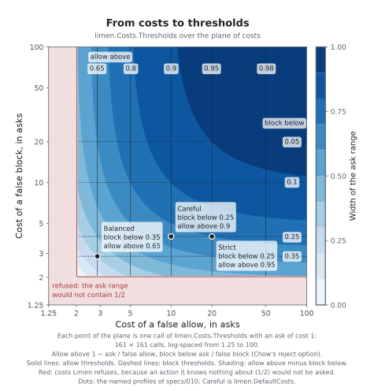
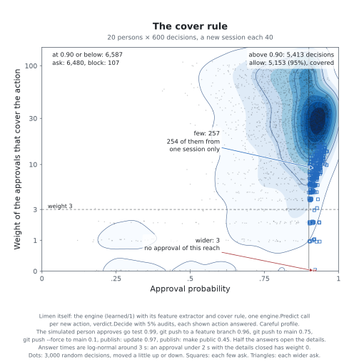
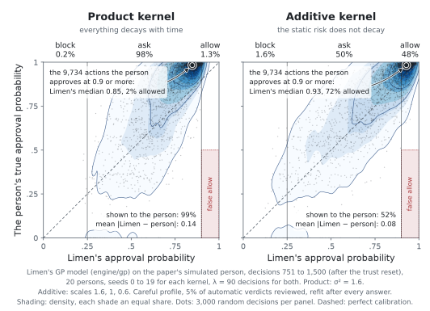

# Theory in brief

This page tells what Limen calculates and why. It is for an engineer who
wants to know the meaning of the numbers in a prediction and in a
reliability report. The paper gives the full argument, the proofs, and
the simulations. The paper is Changkun Ou, *Learning When to Ask: Trust
Calibration for Agentic Tool Use, from Known Tools to Opaque LLM Judges*
([arXiv:2605.19151](https://arxiv.org/abs/2605.19151)).

The cores of the eight propositions of the paper have machine-checked
proofs in Lean 4 with Mathlib. The theorem names on this page are the
names in the development at
[github.com/changkun/trustcalib](https://github.com/changkun/trustcalib).

This page describes the model that the engine uses and the estimates that
the ledger calculates. The paper is about tool calls. Each statement on
this page also applies to any other action that a decision point
observes.

## What Limen predicts

A proposed action $x$ is what the decision point observes before the
action runs. This includes the kind and the name of the action, its
input, its target, where it runs, and the signals about it. The person
for whom the action runs approves it ($y = 1$) or denies it ($y = 0$).
Limen models the answer of the person through a latent value $f$. The
model never observes $f$. It observes only the answers.

$$
\Pr(y = 1 \mid x, t) = \Phi\bigl(f(x, t)\bigr),
\qquad
f(x, t) = \tau(t) - r(x) + h(x, t).
$$

$\Phi$ is the standard normal distribution function. $r(x)$ is the static
risk of the action. $\tau(t)$ is the tolerance of the person at time $t$.
$h$ is a small interaction term. It lets the tolerance change differently
for different actions.

This split is important. The risk of an action is a property of the
action. The tolerance is a property of the person, and it changes with
time.

Time $t$ counts decisions. It is the number of actions that Limen has
for this person in this organization. Each new action that Limen
predicts, or that the decision point records, adds one, also if no
person answers it. Topos records each call that its rules decide, reads
included. Limen gives each action its number in the order of arrival.

Tolerance changes with use, not with the clock. Because Limen keeps this
count itself, an incorrect clock of a caller cannot change it.

The number of calls can change it. After 90 decisions without an
answer, the time parts of the earlier answers, `recent` and
`interaction`, are $e^{-1}$ of their value, approximately 37%. The
static part does not decrease, and the cover rule still needs
considered approvals of the scope. Because of this, many calls move a
probability in the direction of the static value of the action. They
cannot cause an `allow` alone.

## Why approve and deny, not preferences

Limen learns from answers to the question "Do you approve this action?".
It does not learn from comparisons such as "Which of these two actions is
safer?".

**Proposition 1.** Approval probabilities identify $f$ exactly, and also
the boundary $\{x : f(x) > 0\}$ between actions to allow and actions to
deny. Pairwise comparisons, $\Pr(x \succ x') = \Phi(f(x) - f(x'))$, do
not change if you add a constant to $f$. Because of this, for each action,
some different $f$ with the same comparisons puts the action on the other
side of the boundary. (Lean: `unary_identifies`,
`unary_identifies_boundary`, `pairwise_shift_invariant`,
`pairwise_cannot_identify_threshold`.)

Comparisons rank actions, but they cannot tell where to stop. This is why
Limen uses Gaussian-process classification with a reject option. A
classifier with a reject option can decline to classify an input. In
Limen, this option is the verdict `ask`. Preferential Bayesian
optimization is a related method, but Limen is not an instance of it.

## The model

Limen puts a Gaussian-process prior on $f$. A Gaussian process is a
probability distribution over functions. Its kernel gives the covariance
of the values of the function at two inputs. Limen uses a kernel
$k_x$ over actions and their context, and the kernel
$k_{\text{time}}(t, t') = e^{-|t - t'|/\lambda}$ over time. From these
kernels, it makes the additive kernel

$$
k\bigl((x, t), (x', t')\bigr)
= \sigma_s^2\, k_x(x, x')
+ \sigma_g^2\, k_{\text{time}}(t, t')
+ \sigma_d^2\, k_x(x, x')\, k_{\text{time}}(t, t'),
$$

The three terms of this kernel agree with the three parts of $f$ above:
static risk, shared tolerance, and the interaction. Each answer, about any
action, updates the shared tolerance. The usual alternative is the
separable product kernel $\sigma^2 k_x k_{\text{time}}$. With this kernel,
everything changes with time, also the risk of an action. The sections
below show the cost of this. The forgetting scale $\lambda$ is 90
decisions.

The posterior is the distribution of $f$ after the answers of the person.
Limen approximates it with the Laplace method, which uses a normal
distribution at the mode of the posterior. The predictive mean $\mu$ and
the predictive variance $\sigma^2$ of $f$ give the numbers in a
prediction:

$$
\texttt{approve} = \hat p = \Phi\!\left(\frac{\mu}{\sqrt{1 + \sigma^2}}\right),
\qquad
\texttt{uncertainty} = \sigma.
$$

If a person has no answers, $\mu = 0$ and $\hat p = 1/2$. In general, a
large uncertainty moves $\hat p$ in the direction of one half.

An action that is not similar to an answered action keeps a large
variance in its static part. But it shares the tolerance of the person,
and each answer changes the tolerance. Because of this, a new type of
action does not start at one half if the person has other answers.

For example, with the
safety-weighted profile, a person gives 10, 30 and 60 considered denials
to three other types of action: `git_push`, `bash` and `write_file`. A
`deploy` action that never got an answer then gets 0.288, 0.255 and
0.247. At 60 denials, it is below 0.25, and Limen suggests `block`
without an `ask`. The cover rule applies only to `allow`.

## The decision rule

Let $c_{\text{FA}}$ be the cost of a false allow: an action runs, and the
person would deny it. Let $c_{\text{FB}}$ be the cost of a false block: an
action does not run, and the person would approve it. Let
$c_{\text{ask}}$ be the cost of one `ask`. At approval probability $p$,
the expected costs are $(1 - p)\,c_{\text{FA}}$ for `allow`,
$p\,c_{\text{FB}}$ for `block`, and $c_{\text{ask}}$ for `ask`.

**Proposition 2.** The expected cost depends on the posterior only through
$\hat p$. The optimal choice is

$$
\text{allow if } \hat p > \tau_{\text{high}} = 1 - \frac{c_{\text{ask}}}{c_{\text{FA}}},
\qquad
\text{block if } \hat p < \tau_{\text{low}} = \frac{c_{\text{ask}}}{c_{\text{FB}}},
\qquad
\text{ask otherwise.}
$$

The ask range between the two thresholds is not empty if and only if
$c_{\text{ask}}(c_{\text{FA}} + c_{\text{FB}}) <
c_{\text{FA}}\,c_{\text{FB}}$. Otherwise, for each value of $\hat p$,
`allow` or `block` is at least as good as `ask`. (Lean:
`expectedLoss_allow`, `expectedLoss_block`, `band_nonempty_iff`,
`allow_strictly_optimal`, `block_strictly_optimal`,
`ask_strictly_optimal`, `decide_optimal`, `ask_never_needed`.)

A prediction gives the thresholds as approval probabilities: `allow_above`
$= \tau_{\text{high}}$ and `block_below` $= \tau_{\text{low}}$. Above
`allow_above`, the suggestion is `allow`. Below `block_below`, it is
`block`. Between them, with both ends included, it is `ask`.

Limen has one more requirement for a cost profile: the ask range must
contain one half. Limen gives this probability to each action of a person
that it knows nothing about. Then Limen never allows or blocks an action
without evidence. Because $\tau_{\text{low}} < 1/2 \iff c_{\text{FB}} >
2c_{\text{ask}}$ and $\tau_{\text{high}} > 1/2 \iff c_{\text{FA}} >
2c_{\text{ask}}$, the requirement is this: the cost of each type of error
must be more than two times $c_{\text{ask}}$. Limen refuses a profile that
does not obey this requirement, with the error `ask_too_costly`. An ask
range that contains one half is never empty.

| Profile | $c_{\text{FA}}$ | $c_{\text{FB}}$ | $c_{\text{ask}}$ | `allow_above` | `block_below` |
|---|---|---|---|---|---|
| Symmetric | 2.857 | 2.857 | 1 | 0.65 | 0.35 |
| Safety-weighted (the default) | 10 | 4 | 1 | 0.90 | 0.25 |

Only the ratios of the costs are important. The safety-weighted profile
says that a false allow costs as much as ten `ask`s, and a false block as
much as four. Because of this, Limen suggests `allow` only if the approval
probability is above 0.90.

The figure below shows the two thresholds for all costs from 1.25 to 100
times the cost of an `ask`.

<picture>
  <source media="(prefers-color-scheme: dark)" srcset="figures/thresholds-dark.svg">
  
</picture>

*The thresholds that `limen.Costs.Thresholds` calculates, with an `ask` of
cost 1. The shade is the width of the ask range. Limen refuses the costs
in the red area, because there the ask range does not contain 1/2.
Balanced is the symmetric profile, and Careful is the safety-weighted
profile, the default.*

The rule gives a value to an answer only for the current action. An
answer also makes later predictions better. A rule that included this
value could ask slightly less. But the one-step rule is the rule whose
thresholds an operator can calculate directly from the costs.

## Some asks are always necessary

**Proposition 3.** Let a policy know the true approval probability
$q(x)$ of each action, and take the verdict of least expected cost. This
policy must still ask about each action with
$\tau_{\text{low}} < q(x) < \tau_{\text{high}}$. As a result, the fraction
of actions that this policy asks about is at least the fraction of actions
with $q(x)$ in this range. This fraction comes from the ambiguity of the person
at your costs. (Lean: `optimal_asks_on_band`, `escalation_floor`.)

This fraction is the ask rate of the policy with the least expected cost.
It is not a limit for all policies. A policy can ask less only if it
decides some of these actions at a higher expected cost. In the
simulation of the paper, this fraction was 10.3% of actions with the
symmetric profile and 31.3% with the safety-weighted profile.

## Kinds of ask

An `ask` has one of five kinds. Three kinds are an `ask` in the ask
range, and two are an `allow` that the [cover rule](#the-cover-rule)
changed to an `ask`. Each prediction tells which kind applies.

The prior variance at an action is the variance of $f$ before any answer:

$$
v_0 = k\bigl((x, t), (x, t)\bigr) = \sigma_s^2 + \sigma_g^2 + \sigma_d^2.
$$

With the default kernel of the engine, $v_0 = 1.6 + 1.0 + 0.6 = 3.2$.
The predictive variance $\sigma^2$ is never more than $v_0$. The evidence
ratio is

$$
e = 1 - \frac{\sigma^2}{v_0}.
$$

It is the part of the prior variance that the answers of the person
removed. It is near 0 for an action that is not similar to an answered
action. It is near 1 for a familiar action. A prediction gives $e$ as
`evidence_ratio`. For example, `uncertainty` 0.71 gives
$e = 1 - 0.71^2 / 3.2 \approx 0.84$.

For an `ask` in the ask range, Limen compares $e$ with 0.5, and reads the
answers of the family of the action:

- If $e < 0.5$, the `ask_kind` is `unsure`. The answers of the person
  tell little about this action. More answers can move $\hat p$ out of
  the ask range.
- If $e \ge 0.5$ and the answers of the family have an approval and a
  denial, the `ask_kind` is `split`. The answers do not agree.
- If $e \ge 0.5$ and the answers of the family agree, the `ask_kind` is
  `short`. The answers are not enough yet to pass a threshold. More
  answers that agree can move $\hat p$ out of the ask range.

Limen reads the most recent answer of each answered case of the family,
in the window of the model. A family with no answered case agrees. The
weight of an answer does not change the kind.

For example, two approvals of one action and no denial give
$e \approx 0.64$ and $\hat p \approx 0.80$. With the safety-weighted
profile, Limen suggests `allow` only above 0.90, so the `ask_kind` is
`short`. More approvals move $\hat p$ above 0.90.

Proposition 3 is about a policy that knows $q(x)$. The model comes near
$q(x)$ only with many answers. Because of this, Proposition 3 applies to
a `split` ask only in the limit: many answers that stay mixed, with
$q(x)$ in the ask range. Then more answers do not move $\hat p$ out of
the ask range. With few answers, $\hat p$ is not near $q(x)$, and more
answers can move it.

The cut 0.5 is a constant of the engine, `engine.EvidenceCut`. It is a
measure of evidence, not a test of consent. The cover rule is the test of
consent. An `allow` or a `block` has no `ask_kind`. A decision point can
let its rules decide an `unsure`, a `short` and a `few` ask, and keep a
`split` and a `wider` ask for the person. These come from the answers of
that person. [Integration](integrating.md#kinds-of-ask) tells what Topos
does with each kind.

## The cover rule

The cover rule applies after the model and the decision rule. With few
answers, $\hat p$ can already be above $\tau_{\text{high}}$. For example,
one approval of `publish` and no denial give $\hat p \approx 0.73$ and
$e \approx 0.54$. With the symmetric profile, $\tau_{\text{high}} = 0.65$,
so the decision rule gives `allow` after one answer. One approval is not
a pattern. Also, an approval of a preview is not an approval to make an
app public. The model does not know this difference, because the label
`publish` does not tell it.

### The scope

The scope of an action has four dimensions:

| Dimension | Values, from the least reach to the most |
|---|---|
| `undo` | `none`, `reversible`, `recoverable`, `irreversible` |
| `crosses` | each of `machine`, `remote`, `network`, `organization`, `public`: no or yes |
| `target_class` | `scratch`, `own`, `shared`, `primary` |
| `contact` | `repeat`, `first` |

Each dimension also has the value `unknown`. For values
$v_0 < v_1 < \dots < v_k$ of one dimension, $v_i$ is within $v_j$ if
$i \le j$. $v_0$ is within `unknown`, `unknown` is within $v_k$, and
`unknown` is within `unknown`. A middle value and `unknown` are not
comparable. This is a partial order. A scope $s$ is within a scope $a$
if, in each dimension, the value of $s$ is within the value of $a$.
`contact` is not in the order.

Limen reads the scope from the input of the action, with a fixed table of
shell commands, and from the fields `effect` and `reversible`. The
decision point can send claims. For a dimension that both give, the
value is the greater of the two. If the two values are not comparable,
the value is the greatest value. A claim can make the scope wider, but
it cannot make it narrower. Only a hold of the environment can make the
reading of Limen narrower. [Integration](integrating.md#send-the-reach-of-an-action)
gives the fields.

### The cover

The family of an action is the name of its tool, or the words of each
shell segment, for example `git push`. An approval covers an action $x$
if its most recent answer is an approval, its weight is above 0, it has a
family of $x$, and the scope of $x$ is within its scope. Let $W_f$ be the
total weight of the approvals that cover $x$ in the family $f$, and $S_f$
the number of their different sessions. $x$ is covered if, for each
family $f$ of $x$,

$$
W_f \ge w_{\min}, \qquad S_f \ge s_{\min}.
$$

The defaults are $w_{\min} = 3$ and $s_{\min} = 2$, the constants
`limen.MinWeight` and `limen.MinSessions`. A cost profile can make them
greater, and the meet of two profiles takes the greater value. Limen
reads the cases in the window of the model, the 512 most recent answered
cases. A case without a session counts as the session of its UTC day.

If $\hat p > \tau_{\text{high}}$ and $x$ is not covered, Limen suggests
`ask`. The `ask_kind` is `wider` if, for a family of $x$, no approval of
any weight has a scope that the scope of $x$ is within. It is `few` in
the other case. The rule does not change $\hat p$, the uncertainty, the
evidence ratio, or the thresholds. It never changes a `block` or an
`ask`.

Proposition 2 gives the verdict of least expected cost among `allow`,
`ask` and `block`. The cover rule removes `allow` from the choices where
the person gave no consent to the reach of the action. Limen then takes
the verdict of least expected cost among the choices that are left. The
paper measured the problem that this solves (section Generalization to
never-labelled actions). Where the scope is new, Limen asks, as the
per-cell learner of the paper does. Where the scope is covered, the
kernel still transfers approval.

| Answers of `publish` (an update) | $\hat p$ | $e$ | Symmetric (0.65) | Safety-weighted (0.90) |
|---|---|---|---|---|
| 1 considered approval | 0.73 | 0.54 | `ask`, `few` | `ask`, `short` |
| 3 considered approvals in 1 session | 0.85 | 0.69 | `ask`, `few` | `ask`, `short` |
| 3 considered approvals in 2 sessions | 0.85 | 0.69 | `allow` | `ask`, `short` |
| the same, for a `publish` that makes the app public | 0.85 | 0.69 | `ask`, `wider` | `ask`, `short` |

The figure below shows the cover rule over many decisions of the engine.

<picture>
  <source media="(prefers-color-scheme: dark)" srcset="figures/cover-dark.svg">
  
</picture>

*Each point is one prediction of the engine for a new action of a
simulated person, with the safety-weighted profile. Above 0.90, Limen
suggests `allow` only if approvals of weight 3 or more from 2 sessions
cover the action. The other actions above 0.90 get a `few` or a `wider`
ask.*

### The weight of an answer

Most answers are habit. A model that learns from habit learns the habit,
not the consent. The weight of an answer, `weights/1`, is 0 or 1. A
denial has weight 1, except a denial from a standing rule. An approval
has weight 0 if one of these is true:

- A standing rule gave it (`surface` is `rule`).
- One gesture answered more than one action (`surface` is `bulk`).
- The time of the answer is less than 2000 ms.
- The client showed the suggestion of Limen, the shown $\hat p$ was above
  0.5, and the approval followed it.
- 50 reviews or more of the same person came before it in its session.

Each rule but the first applies only if the person did not open the
details. The time of an answer is the smallest of `answer_ms`,
`waited_ms`, and the time from the recorded decision to the answer. In
the model version `learned/1`, the weight applies to the cover rule
only. Each answer still trains the model. In `learned/2`, the weight
also applies to the fit ([model versions](#model-versions)).

No estimate reads the weight. A review counts with the weight
$1/\pi$ of its review probability, as Proposition 8 needs. A weight that
depends on the answer would bias the estimate toward the answers that
the person gave slowly. The cover rule changes which actions a person
sees. It does not change the probability with which a person sees them,
because the decision point fixes that probability after the prediction.
So the estimates stay unbiased. The certificate gives one more count,
`considered`: the audits of its clean run whose answer has weight 1.

Explanations, the entries of `GET /v1/learned`, and replays also apply
the cover rule. A preview applies the cover that each prediction
recorded, and does not calculate it again. A reliability report reads the
recorded predictions.

## Model versions

A model version sets the features, the kernel, the likelihood, and the
window of the model. Each prediction gives its version in `source`.
Limen keeps the fitted model of each version apart, and a version never
reads the fitted model of a different version.

| Version | Features | Likelihood | Weight of an answer in the fit |
|---|---|---|---|
| `learned/1` | `features/1` | probit | none: each answer counts in full |
| `learned/2` | `features/2`: `features/1` with the scope | probit with weights | `weights/2` |

The two versions use the same kernel, the same hyperparameters, and the
512 most recent answered cases. In both versions, the cover rule reads
`weights/1`. `limend` uses `learned/1` if the operator does not set
`LIMEN_MODEL` ([Running](running.md#switch-the-model)).

### The scope in the features

`features/2` puts the scope of an action into the kernel. It replaces
three groups of `features/1`: the irreversibility of the action, the
destructive pattern, and the outside-workspace rule. In their place, it
has `undo`, each boundary of `crosses`, `target_class`, `contact`, and
the holds of the environment.

| Group | Encoding |
|---|---|
| `undo` | three steps of $\sqrt{2/3}$ over `reversible`, `recoverable`, `irreversible`. `none` is 0. `unknown` is one half of each step. |
| each boundary of `crosses` | `no` is 0, `unknown` is $\sqrt 2/2$, `yes` is $\sqrt 2$ |
| `target_class` | three steps of $\sqrt{2/3}$ over `own`, `shared`, `primary`. `scratch` is 0. `unknown` is one half of each step. |
| `contact` | `repeat` is 0, `unknown` is $\sqrt 2/2$, `first` is $\sqrt 2$ |
| holds | $\sqrt{2/3}$ for each hold of the environment |

Two actions that differ only in one group are at a squared distance of 2
or less, as in `features/1`. One boundary that one action crosses and the
other does not multiplies the kernel of the action block by
$e^{-2/(2 \cdot 1.1^2)} \approx 0.44$. `publish: update` and
`publish: make public` differ in `undo` and in `crosses.public`, so the
kernel of the action block falls to approximately 0.33.

With `features/1`, these two actions have the same features. The model
then reads an approval of an update as an approval to make the app
public. Only the cover rule tells them apart. With `features/2`, an
approval of one tells less about the other.

A case keeps its `features/1` vectors and its scope. `features/2` uses
no part of the input that these do not keep. Because of this, Limen
calculates the `features/2` vectors of a stored case from its records,
and they are the vectors that the case had when it was new.

### The weighted likelihood

`learned/2` multiplies the log likelihood of each answer by the weight
$w_i$ of the answer:

$$
\log p(\mathbf y \mid \mathbf f) = \sum_i w_i \log \Phi(s_i f_i),
$$

where $s_i = 1$ for an approval and $s_i = -1$ for a denial. Let
$z_i = s_i f_i$ and $r_i = \phi(z_i)/\Phi(z_i)$. The gradient and the
negative second derivative for answer $i$ are

$$
g_i = w_i\, s_i\, r_i,
\qquad
W_i = w_i \bigl(r_i^2 + z_i r_i\bigr) \ge 0.
$$

These are $w_i$ times the values of the probit without weights. Because
each $W_i$ is 0 or more, the log likelihood stays concave. The Newton
steps of the Laplace method then converge as they do without weights.
The posterior mean, the variance, and $\hat p$ have the same formulas as
before.

- With each weight 1, the fit gives the same numbers as `learned/1`, bit
  for bit. The tests compare it with the golden fixtures of the research.
- An answer with weight 0 adds nothing to the likelihood. The fit leaves
  it out. The window of 512 cases comes first, so the window is the same
  as in the cover rule.
- An explanation still adds up exactly:
  $\mu(x) = \sum_i k(x_i, x)\, g_i$, with the weighted $g_i$.

A likelihood with weights is a tempered likelihood. It is not in the
paper, and no proposition of the paper is about it. The paper names a
remedy for answers from habit: a model in which the noise of an answer
increases with the number of asks (section Limitations). A tempered
likelihood is a version of that remedy, and the Laplace method applies to
it with no change. Because the paper does not test it, an operator
compares the two versions on the recorded history before the change
([Running](running.md#switch-the-model)).

### The weights of `weights/2`

`weights/2` gives a weight between 0 and 1 where `weights/1` gives 0.
The rules and the settings are the rules and the settings of
`weights/1`.

| Answer | Weight |
|---|---|
| a denial | 1, or 0 from a standing rule |
| an approval from a standing rule | 0 |
| an approval with the details opened, and no standing rule | 1 |
| an approval with one gesture for many actions, or in less than 2000 ms | 0.2 |
| an approval that followed a suggestion that the client showed | the weight times 0.5 |
| an approval with 50 reviews or more before it in its session | the weight times 0.5 |
| an approval that no rule applies to | 1 |

For example, a quick approval that followed a suggestion has the weight
0.1. The cover rule keeps `weights/1`, so an approval with a weight below
1 in `weights/2` does not build the cover. No estimate reads either
weight.

The table gives the approval probability of a `publish: update` after
each approval. The engine tests and the model comparison measure these
numbers. With the safety-weighted profile, Limen suggests `allow` only
above 0.90.

| Approvals | 1 | 2 | 3 | 4 | 5 | 6 | 7 |
|---|---|---|---|---|---|---|---|
| `learned/1`, each approval | 0.729 | 0.805 | 0.845 | 0.870 | 0.887 | 0.899 | 0.908 |
| `learned/2`, approvals with weight 1 | 0.729 | 0.805 | 0.845 | 0.870 | 0.887 | 0.899 | 0.908 |
| `learned/2`, approvals in 1 second | 0.579 | 0.633 | 0.673 | 0.703 | 0.727 | 0.747 | 0.763 |

## Explanations

The Laplace posterior mean is a sum over the answers of the person:

$$
\mu(x) = \sum_i k(x_i, x)\, g_i.
$$

Here $g_i$ is the gradient of the log likelihood at the mode of the
posterior, for answer $i$. It is positive for an approval and negative
for a denial. It is larger if the answer disagrees more with the mode.
In `learned/2`, it includes the weight of the answer.

An explanation gives the part of each answer, $c_i = k(x_i, x)\, g_i$.
The parts add up to $\mu(x)$ exactly. The `share` of an answer is
$|c_i| / \sum_j |c_j|$.

The additive kernel also divides $\mu$ into the three terms of the
kernel. Each term is a sum over the same $g_i$:

- `action` $= \sigma_s^2 \sum_i k_x(x_i, x)\, g_i$: what the model
  learned about this type of action, at any time.
- `recent` $= \sigma_g^2 \sum_i k_{\text{time}}(t_i, t)\, g_i$: the
  recent tolerance of the person, from all recent answers.
- `interaction` $= \sigma_d^2 \sum_i k_x(x_i, x)\, k_{\text{time}}(t_i, t)\, g_i$.

The three parts add up to $\mu(x)$ exactly. The product kernel has no
parts. An explanation of its prediction gives only the parts of the
answers and the evidence ratio.

## The cost of forgetting

$k_{\text{time}}$ gives recent answers more weight. This lets the model
follow a change of tolerance. But it also moves each action that gets no
more answers back in the direction of the prior, the model before any
answer.

**Proposition 4.** With the separable product kernel, after the answers
stop, the latent mean of each action decays as $\mu(t + \Delta) =
e^{-\Delta/\lambda}\mu(t)$. Because of this, each action comes back into
the ask range. After at most $\lambda \ln(m/z)$ steps, where
$z = \Phi^{-1}(\tau_{\text{high}})$, an action with mean $m > 0$ is no
longer allowed. With
the additive kernel, only the time terms decay, and the mean converges to
its static part. (Lean: `kT_shift`, `meanProd_shift`, `quadForm_shift`,
`exp_decay_tendsto`, `eventually_ask`, `reentry_bound`, `reentry_prob`,
`meanAdd_shift`, `meanAdd_tendsto`.)

With $\lambda = 90$ and $\tau_{\text{high}} = 0.65$ ($z \approx 0.385$), an
action with $m = 2$ comes back into the ask range within
$90 \ln(2/0.385) \approx 148$ decisions. This occurs also if the person
did not change. In the simulation, the prediction of the product kernel for a
harmless file read decayed from 0.65 to 0.50 without new answers. The
prediction of the additive kernel converged to its static part, 0.76.

The figure below shows the same effect for all decisions after a trust
reset, with the safety-weighted profile.

<picture>
  <source media="(prefers-color-scheme: dark)" srcset="figures/forgetting-dark.svg">
  
</picture>

*Decisions 751 to 1,500 of 20 simulated persons, after a trust reset. The
product kernel forgets the risk of each action and asks about almost all
actions. The additive kernel keeps the risk and allows about half of the
actions.*

## Generalization has two effects

Because of the kernel, an answer about one action also changes the
predictions for similar actions. Because of this, Limen needs far fewer
answers than a table with one entry for each kind of action and target.
But approval also moves to similar actions that are dangerous. An action
that is similar to approved actions gets their approval.

In the simulation, one action was a force push to production
infrastructure. This action never had an answer, and the person mostly
denies it. Of the 64 occurrences that the person would deny, the additive
model allowed 7 (11%). Reviews and the ceiling exist for this case.

## The ledger: error rates of any source

Only the actions that a person sees get answers. These actions are the
actions that were already in doubt. This does not bias the posterior of
the model. But it biases each error rate that comes from a count of the
answers. The solution is a probability that the decision point records
with each decision.

For each action $i$, a decision point records the verdict that it applied
and the probability $\pi_i$ that a person sees the action. It sets
$\pi_i$ before the action runs. The value of $\pi_i$ is:

- 1 for an `ask`.
- The audit rate $\varepsilon$ for an automatic verdict under random
  selection for audit. This applies if the random selection selected the
  action or not.
- 0 if no random selection applies to the action.

`verdict.Decide` returns exactly these two values: the verdict and
$\pi_i$.

**Proposition 5.** (a) Let the review indicators $A_i$ have mean
$\varepsilon > 0$. An indicator is 1 if its event occurs and 0 if not.
Let $e_i$ be the false allow indicators over $N$ automatic allows. Then
the Horvitz-Thompson estimator $\sum_i A_i e_i / (N \varepsilon)$ is
unbiased for the realized false allow rate. A Horvitz-Thompson estimator
gives each observed item the weight one over its probability of
observation.

(b) If the true rate is at least $\alpha$, the probability that $n$
independent audits are all clean is at most $(1 - \alpha)^n \le
e^{-\alpha n}$. A clean audit is an audit that finds no false allow.
This probability is at most $\delta$ if

$$
n \ge \frac{\ln(1/\delta)}{\alpha}.
$$

(Lean: `audit_unbiased`, `one_sub_pow_le_exp`, `certify_sample_size`.)

| Claim: false allow rate below | Confidence | Consecutive clean audits |
|---|---|---|
| 25% | 95% | 12 |
| 1% | 95% | 300 |

**Proposition 8** makes (a) general. If action $i$ gets an answer with a
known probability $\pi_i > 0$, an estimate that gives each answer the
weight $1/\pi_i$ is unbiased. Then the answers to an `ask` ($\pi = 1$) and
the answers to an audit ($\pi = \varepsilon$) count together. (Lean:
`ht_unbiased`.)

The ledger applies this to all sources of verdicts at the same time. A
source $s$ can be the suggestions of Limen, or the verdicts that decision
points applied. It can also be one policy of a decision point, or one
signal, for example a judge. Its allows $A_s$ are the actions for which
it gave `allow`. Of these, the covered actions
$C_s = \{i \in A_s : \pi_i > 0\}$ are the actions that a person could
see. The estimate of the false allow rate of the source over these
actions is

$$
\widehat{\mathrm{FA}}_s = \frac{1}{|C_s|} \sum_{i \in C_s} \frac{L_i\, e_i}{\pi_i},
$$

Here $L_i$ is 1 if action $i$ has its review answer, and $e_i$ is 1 if
that answer was a denial. This estimate is unbiased for the false allow
rate over $C_s$. A report gives `covered` $= |C_s| / |A_s|$, because the
estimate applies only to the covered part. If $C_s$ is empty, the rate is
`null`. This means that nobody can estimate the rate. It does not mean
zero.

The 95% interval is a Wilson interval, a confidence interval for a
proportion. Limen calculates it at the Kish effective sample size
$(\sum w)^2 / \sum w^2$ of the review weights $w = 1/\pi$. This is an
approximation. The interval becomes wider if a small number of reviews
with large weights carry the estimate. False block rates use the same
method, with blocks and approvals in place of allows and denials.

This has two results. First, nobody set a probability for a later answer
before the action ran. An example is a dispute of an action that ran
without an `ask`. Limen uses such an answer to train the model, and never
in an estimate.

Second, an action that a person saw but did not answer counts as
`unanswered`. The estimate treats it as missing at random. A long queue
of reviews makes this assumption doubtful.

In the simulation, an audit rate of 5% increased the answers per action
from 13.5% to 18.2%. Audits also halved the allows while a rare veto was
active: from 11 to 5 of 109.

Regret is the extra cost compared with the best possible decisions. If
each audit costs as much as one full `ask`, audits increased the average
regret: 0.056 without audits, and 0.089 with audits. Audits are worth
their cost if one audit costs at most 0.22 of an `ask`. Audits make it
possible to estimate the error rate. They do not make the error rate
small.

## Calibration

An approval probability is calibrated if it is true on average. Of the
actions to which Limen gave 0.9, the person approves about 90%. The
model is calibrated only if its assumptions are true for the person. A
person who approves from habit, or who follows a lean that a client
showed, can make a calibrated model wrong. A client must not show a
number that the reviews do not support.

The calibration report measures this for one person and one period of
time. It puts the predictions of the period in ten bins of the approval
probability: 0 to 0.1, and so on up to 0.9 to 1. For each bin
$b$, the covered cases $C_b$ are the cases whose review probability
$\pi_i$ is more than 0. The report compares two numbers:

- `stated`, the mean approval probability of the cases in $C_b$.
- `observed`, the approval rate of the cases in $C_b$, from their
  reviews.

`observed` is a Horvitz-Thompson estimate, as in the reliability report.
Each review has the weight $1/\pi_i$, and the weight of an answer does
not apply. By Proposition 8, the estimate is unbiased, and it includes
both the asks and the audits. A bin below 0.5 estimates the part of
$C_b$ that the person approves:

$$
\widehat{O}_b = \frac{1}{|C_b|} \sum_{i \in C_b} \frac{L_i\, y_i}{\pi_i},
$$

Here $y_i$ is 1 if the review approved. A bin of 0.5 or more estimates
the part that the person denies, and `observed` is 1 minus that part.
With this choice, `observed` of a bin above the allow threshold is 1
minus the false allow rate of its allows.

Both estimates are unbiased, but their variance is different. The
reviews of a high bin are mostly audits, and almost all of them approve.
Then the count of approvals changes with the number of audits that the
random selection drew. The count of denials does not change much. In a
test, 1,000 cases had the approval probability 0.95 and an audit rate of
5%. The 95% interval of the approvals held the true rate in 68% of the
runs, and the interval of the denials in 96%.

The interval is the Wilson 95% interval at the Kish effective size of the
review weights, as in the reliability report. If the effective size is
less than 20, the bin is `not_estimable` and `observed` is `null`. Then
the interval is too wide to tell a calibrated bin from a bin that is not
calibrated. With 20 reviews of weight 1 that all approve, the interval
is about 0.84 to 1.

| `state` | Condition |
|---|---|
| `not_estimable` | The effective size is less than 20. |
| `calibrated` | `stated` is in the interval. |
| `overconfident` | `stated` is outside the interval and further from 0.5 than `observed`. |
| `underconfident` | `stated` is outside the interval and not further from 0.5 than `observed`. |

A bin is `calibrated` in about 95% of the periods if the model is
calibrated, because the interval is a 95% interval. A test of Limen
simulates 400 ledgers of a calibrated model, with asks at review
probability 1 and audits at 10%. Of the estimable bins, 94.5% were
`calibrated`, and each bin was `calibrated` in 91% or more of the
ledgers. A model that stated 0.1 less than the truth was `calibrated` in
26% of the bins.

The review probability of each decision, not the thresholds, sets which
cases get a review. The cover rule can change an `allow` above the allow
threshold to an `ask` of kind `few` or `wider`. This action gets a review
when a person sees it. A decision point can send a `few`, `short` or
`unsure` ask back to its rules. If the rules then allow the action, the
decision point records the audit rate as the review probability and
draws an audit.

Each review counts with the weight $1/\pi$, so the estimate stays
unbiased. Without audits, the actions that ran or were blocked without a
person have no review. A bin of only these actions stays
`not_estimable`.

`error` is the mean distance between `stated` and `observed` over the
estimable bins, each bin weighted by its number of cases. `estimable` is
the part of the cases that are in an estimable bin. A small `estimable`
tells you that most predictions have no measurement.

The rule for clients follows from the study of analysts in the
[consent spec](../specs/011-consent.md): people follow an opinion that
they see first. A client shows the approval probability only for a bin
that is `calibrated` in the report of the last 90 days. For a bin above
the allow threshold, the certificate of the suggestions of Limen must
also hold. The certificate tests the actions that ran without a person.
[Integration](integrating.md#the-calibration-report) gives the rule.

## What you can know about a judge

Let $J$ be a judge that returns `allow` or `block`. Let a person have the
approval probability $q$. The error rates of the judge for that person
are

$$
\mathrm{FA}_J = \Pr(y = 0 \mid J = \text{allow}),
\qquad
\mathrm{FB}_J = \Pr(y = 1 \mid J = \text{block}).
$$

**Proposition 6.** Nobody can learn $\mathrm{FA}_J$ from the verdicts of
the judge. For each allow rate in $(0, 1)$, each value of $\mathrm{FA}_J$
in $[0, 1]$ is possible. You can know how often the judge allows and how
often the person approves, and $\mathrm{FA}_J$ is still not fixed. For
example, two situations with a judge allow rate of 0.8 and a person
approval rate of 0.9 can have $\mathrm{FA}_J = 0$ and $\mathrm{FA}_J =
1/8$. (Lean: `judge_unidentified`, `judge_marginals_not_enough`.)

More judges do not help. A latent-class model estimates the error rates
of annotators without the true answers. It can find the error rates of an
annotator from three or more annotators. But it can do this only if the
errors of the annotators are independent given the truth. The errors of
language models are strongly correlated.

**Proposition 7.** For a fixed judge, let the approval probability of
person A be at most that of person B on each action that the judge allows.
Then the false allow rate of the judge for A, the stricter person, is at
least as high as for B. As a result, the trustworthiness of one unchanged
judge depends on the person whose decisions it replaces, and on the time.
(Lean: `judgeFA_mono`.)

Because of this, the ledger reports the error rates of a judge for each
person and for each period of time. It uses answers with known
probabilities (Proposition 8). In some designs, a person sees an action
only after the judge blocks it. In these designs, no action that the
judge allows ever gets an answer. Each such probability is zero, and
nobody can estimate $\mathrm{FA}_J$ at all. The report then gives
`covered` as zero and the value as `null`.

For one verdict, the probability that it is correct is the calibrated
$\hat p$ of Limen for that action, with the verdict as an input. What the
other inputs can distinguish limits the quality of this $\hat p$.

## What the simulation showed, and its limits

No public dataset records the approve and deny decisions of one person
while the tolerance of the person changes. Because of this, the paper
evaluates the method in a controlled simulation with a known oracle. The
oracle is the simulated person. The simulation knows the true approval
probabilities of the oracle.

The numbers below are results of the simulation. They show that the
inference is correct under the model. They do not show that real people
behave like the model.

| Result | Separable product kernel | Additive kernel |
|---|---|---|
| Answers needed per action, symmetric costs | 28.4% | 13.5% (the policy of least cost: 10.3%) |
| Cost-weighted regret | 0.137 | 0.056 (59% lower) |
| False allow rate | 1.2% | 1.0% |
| Actions with an `ask`, safety-weighted costs | 99.1% | 45.9% (the policy of least cost: 31.3%) |

The simulation also compared two ways to select the actions that a
person answers: by the ask range, and at random. With the product kernel,
selection by the ask range was not better. With the additive kernel, it
was better by approximately 3 points of accuracy on contested actions.
The kernel, and so the forgetting, controlled the result. The rule that
selects the actions (the acquisition rule) did not.

The judge study had a registered plan before it ran. Its results:

- If the judge decided alone, the regret was 0.296.
- If its blocks became asks, the regret was 0.088, with 25.3% answers per
  action.
- A calibrated gateway that used the verdict of the judge as an input got
  0.086, with 11.8% answers per action.

In the simulation, the tolerance of the person decreased suddenly at one
time (a trust reset). The false allow rate of the same judge for this
person was 2.9% before the trust reset, 10.0% after it, and 3.4% later.
The estimates from audits followed this rate without bias, but with
noise, with 8 to 24 answers in each period. The gateway did not find a blind spot of the judge: destructive
shell commands that looked harmless to the judge. Of the 29 such actions
that the person would deny, the gateway still allowed 23. It allowed them
because they also looked like harmless commands in the inputs of the
gateway.

The limits are as important as the numbers:

- The oracle is additive by design. This favors the additive kernel. The
  size of the gain is an indication only.
- The simulated judge blocks approximately one quarter of all actions.
  The reported false positive rate of a production classifier is 0.4%,
  which is much less. Because of this, the simulation overstates the gain
  when the blocks of the judge become asks.
- The simulated person has noise but no bias. Real people approve almost
  every prompt that they see. They also become less careful when prompts
  repeat. A model calibrated to a person who approves everything learns to
  approve everything.
- Reliability that Limen estimates from ordinary reviews tells nothing
  about an attacker. Prompt injections that an agent wrote have passed
  production judges.
- Calibration cannot find what its inputs do not show. An input that
  shows a blind spot repairs it, for example a feature of the arguments of
  the command. More calibration does not repair it.
