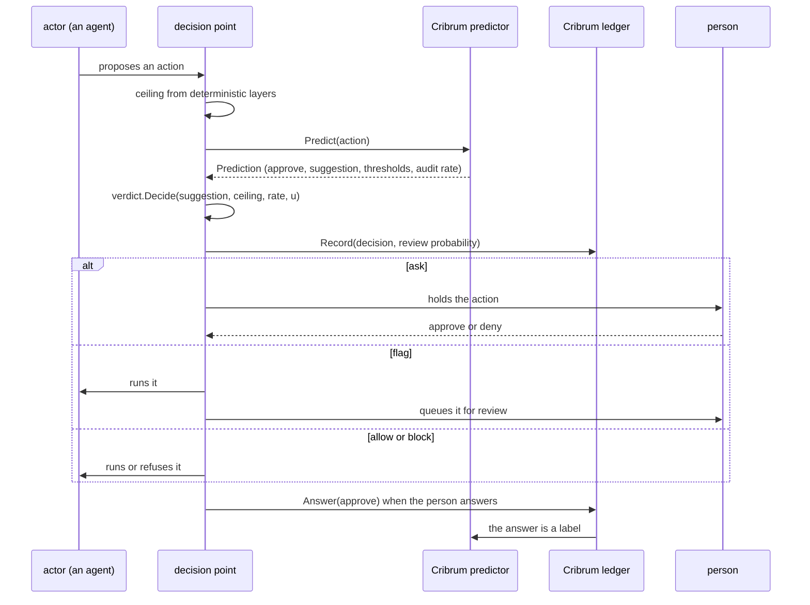

# Architecture

## Overview

Automated actors propose actions that something must let run, hold for a
person, or refuse: an agent's tool call, a sandbox's network request, a
push to a protected branch, a payment, a public share link, a deploy.
The code that makes that choice is a decision point. Most decision
points decide with a fixed list or a fixed score threshold, answer
uncertainty with a refusal, and cannot say how often they are wrong. A
refusal does not pause the actor: an agent reads it as a result and
routes around it. A fixed threshold does not learn that a person approves
one kind of action on sight and wants to see another every time, or
that their tolerance changes when they move to an unfamiliar system. And
an automatic allow never receives an answer, so its error rate is never
observed.

Cribrum is the oversight layer for those decisions. It is three orthogonal
parts, each usable without the parts that build on it:

1. **A shared vocabulary**, `latere.ai/x/pkg/verdict`: the four verdicts
   in their order, composition that can only narrow, the rule that a
   failure is never more permissive than an ask, and `Decide`, which
   applies a ceiling and random review sampling to a suggested verdict
   and returns the probability that a person sees the action. Every
   decision point in the family composes its layers with it.
2. **A ledger**, which keeps every decision a decision point made, with
   that probability, and every answer a person gave, and reports how
   often any source of decisions allows what the person would deny: a
   rule, an LLM judge whose verdict arrived as a signal, the verdicts
   applied, or Cribrum's own predictions. A decision point that decides by
   rules alone can use the ledger to learn how often its rules, and the
   judge it consults, are wrong.
3. **A predictor**, which learns each person's tolerance from the
   ledger's answers and suggests a verdict from the costs their
   organization states.

The decision point owns the decision. It asks the predictor, composes
the suggestion with its own deterministic layers and its review draw,
applies the result, and records it in the ledger. That division is the
architecture's main decision: whoever applies a verdict is the only
party that knows the probability with which a person sees the action,
so the probability is recorded by the decision point and never inferred
by Cribrum.

The design follows the research in *Learning When to Ask: Trust
Calibration for Agentic Tool Use, from Known Tools to Opaque LLM Judges*
([arXiv:2605.19151](https://arxiv.org/abs/2605.19151)), whose
propositions are machine-checked in Lean 4 at
[github.com/changkun/trustcalib](https://github.com/changkun/trustcalib).

## Design

### The flow of one action

1. The decision point evaluates its deterministic layers (deny lists,
   always-confirm lists, modes, hooks) and takes their least permissive
   verdict as the ceiling. A ceiling of `block` is a deterministic deny,
   final whatever Cribrum predicts.
2. It calls `Predictor.Predict` with the `Action`, wrapped in
   `FailClosed`, so an error or a timeout is a prediction of `ask`.
3. It calls `verdict.Decide(prediction.Verdict, ceiling,
   prediction.AuditRate, u)` with a uniform `u` drawn once for this
   action, and applies the verdict.
4. It calls `Ledger.Record` with the verdict, the review probability and
   its own source name. It records every decision, not only those a
   person sees, because a source's allows are the denominator of its
   error rate.
5. When the person answers, it calls `Ledger.Answer`. The ledger derives
   what the answer counts for from the recorded decision
   ([[008-ledger-and-estimation]]).

### The action

An `Action` is generalized beyond tool calls. `Kind` is the domain and
`Name` the operation within it:

| Domain | Kind | Name, for example | Typical decision point |
|---|---|---|---|
| agent tool calls | `tool` | `bash`, `write`, `mcp__github__merge_pull_request` | an agent harness |
| network from a sandbox | `egress` | `https`, `ssh` | a sandbox's egress gateway |
| repository writes | `repo` | `ref.update`, `ref.delete` | a git host |
| storage | `storage` | `share.create`, `link.create` | an object store |
| spending | `spend` | `charge`, `budget.raise` | a model gateway or a payments service |
| deploys | `deploy` | `create`, `rollback` | an application platform |

The rest of the action is what the decision point can observe before the
action runs: who proposed it (`Actor`), its widest `Effect` (none, read,
write, external), whether it is `Reversible`, its `Input` (read by
deterministic extractors only, never stored), its `Target` and the
target's sensitivity, the `Environment` it runs in, domain
`Attributes`, and `Signals`, the other opinions the decision point
already has. Cribrum keeps time itself ([[004-engine]]).

### Packages

| Path | What it holds | Spec |
|---|---|---|
| module root | the contract: types, interfaces, error codes, the cost arithmetic, `FailClosed` | [[002-contract]] |
| `authorizer/` | the action vocabulary for the shared authorizer contract | [[003-http-api]] |
| `api/openapi.yaml` | the HTTP surface, held to the Go types by a test | [[003-http-api]] |
| `estimate/` | the estimators, shared by the stub and the engine | [[008-ledger-and-estimation]] |
| `stub/` | an in-memory `cribrum.Service` with a pluggable predictor, for the test tiers of decision points | [[006-conformance]] |
| `conformance/` | the suite every `cribrum.Service` passes | [[006-conformance]] |
| `engine/kernel`, `engine/gp` | the additive kernel and the Laplace GP-probit, ported from the research | [[004-engine]] |
| `engine/featurize` | the open-set featurizer | [[004-engine]] |
| `engine/store` | the memory, file and Postgres stores | [[004-engine]] |
| `engine/` | the in-process `cribrum.Service` | [[004-engine]] |
| `client/` | the HTTP `cribrum.Service` | [[003-http-api]] |
| `cmd/cribrumd` | the server | [[003-http-api]] |
| `cmd/cribrum-hook` | the decision point for hook-based harnesses | [[005-adapters]] |

### Deployment

A decision point that runs as one process with its own state, such as a
local agent CLI, embeds `engine/` in process. A decision point that runs
on many machines, such as hosted agent runners that move between hosts
and hold no store credential, calls one `cribrumd` over HTTP through
`client/`. Both satisfy `cribrum.Service`, so the decision point codes
against one interface. `FailClosed` wraps both: 200 milliseconds in
process, 2 seconds over HTTP from a hook. Predictions never fit a model
on the hot path; fitting runs in the background ([[004-engine]]).

### Invariants

Every implementation holds these, and [[006-conformance]] checks each
that a `cribrum.Service` can show:

1. **A deterministic deny is final.** It lives in the decision point's
   ceiling; `verdict.Decide` never returns anything but `block` under a
   `block` ceiling, and nothing Cribrum predicts reaches past it.
2. **A failure asks.** `FailClosed` turns an error or a timeout into a
   prediction of `ask`; `verdict.OnFailure` is never more permissive than
   `ask`.
3. **The review probability is the decision point's, drawn once.** It is
   recorded with the decision, never inferred by Cribrum, never supplied by
   the person answering, and a decision is recorded once per key.
4. **An unknown action is an ask.** A subject Cribrum knows nothing about
   has approval probability one half, and every cost profile Cribrum
   accepts puts one half inside the ask band.
5. **Input is never stored.** Extractors read `Action.Input` at
   prediction time; the features are kept, the input is dropped, and no
   language model inside Cribrum reads it.
6. **An answer's role follows from the decision.** The first answer to
   an action a person was shown is its review; every other answer trains
   and never enters an estimate.
7. **One key, one action.** A key names one action; a second action
   under the same key is refused.
8. **A person's records are theirs.** Forgetting a subject in an
   organization removes every case, answer and model of theirs there.

### Identity

`cribrumd` verifies bearer tokens from the issuers its operator lists and
asks the installation's authorization endpoint, through
`latere.ai/x/pkg/authz`, for the route's action before it acts, with the
resource fields [[003-http-api]] names. With no endpoint configured it
applies the shared owner policy. The repository's identity role becomes
`core` in the change that adds `cribrumd`.

### Dependencies

The root package is imported into every decision point's hot path, so it
reaches the standard library and `latere.ai/x/pkg/verdict` only; a test
parses its imports and `.lateregate.yaml` records the decision. The
engine's numerical dependency (gonum) lives under `engine/` alone.

### Non-goals

Cribrum does not execute actions, hold the approval inbox, route an
escalation to a particular reviewer, issue identities, or read the
transcript of an agent. It does not choose which actions to show a
person for the sake of learning (value of information) beyond the random
review the decision point draws.

## Acceptance criteria

| # | Criterion | Proved by |
|---|---|---|
| 1 | The root package imports only the standard library and `latere.ai/x/pkg/verdict` | `TestRootImports` and the `depcheck` gate |
| 2 | Every package named in the table exists with the role given, or its spec is still open | review against the tree at each spec's completion |
| 3 | `verdict.Decide` never returns a verdict more permissive than its ceiling, and its probability is positive exactly for shown verdicts drawn or forced | the `verdict` package's tests and fuzz targets |
| 4 | Each invariant a `cribrum.Service` can show has a case in the conformance suite | [[006-conformance]] |
| 5 | The engine and the client both satisfy `cribrum.Service` and pass the conformance suite | `conformance.Run` in `engine/` and in an e2e test against `cribrumd` |
