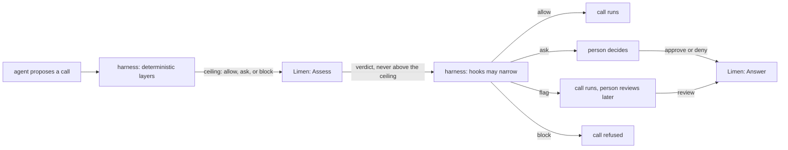

# Architecture

## Overview

An agent harness decides, for every tool call an agent proposes, whether
the call runs, waits for a person, or is refused. Most harnesses decide
with a fixed list or a fixed score threshold, and most answer uncertainty
with a refusal. A refusal does not pause the run: the agent reads it as a
result and routes around it, often in a way that is worse than asking
would have been. The missing verdict is not block but ask, and when to
ask depends on the person the agent acts for, who approves some calls on
sight and wants to see others every time, and whose tolerance changes
when they move to an unfamiliar system.

Limen learns that tolerance from the person's own answers. For one
proposed call it returns the probability that this person approves it,
the verdict that probability implies under the costs the organization
states for a wrong allow, a wrong block, and an interruption, and, for a
small random share of automatic verdicts, an audit that shows the call to
the person anyway so that Limen's own error rate stays measurable. It
also reports how often any judge whose verdict the harness passes in, for
example an LLM classifier, allows what this person would deny.

Limen is one input to a harness's decision, never the decision point.
The harness's deterministic layers (its hard boundaries, its always-deny
and always-confirm lists) run first and hand Limen a ceiling; Limen's
verdict is never more permissive than that ceiling, and a harness's own
hooks may still narrow it afterwards.

The design and its arithmetic come from the research in
[arXiv:2605.19151](https://arxiv.org/abs/2605.19151), whose propositions
are machine-checked in Lean 4 and whose simulation and reference code are
at [github.com/changkun/trustcalib](https://github.com/changkun/trustcalib).
This spec fixes the pieces, the data flow, the store, the identity model,
and the invariants every later spec assumes.

## Design

### Where Limen sits

A deterministic deny is final because it arrives as `ceiling: block`,
and [`Least`](../verdict.go) of anything with `block` is `block`. An
always-confirm rule arrives as `ceiling: ask`, so Limen can record and
learn from the person's answer but cannot remove the ask. Limen removes
an ask only where the deterministic layers left `allow` open, which is
the only place a learned tolerance has anything to add.

### The pieces

| Package or path | Holds | Imported by | State |
|---|---|---|---|
| module root, `latere.ai/x/limen` | the types, the `Gate`, `Reviews` and `Admin` interfaces, the error table, the pure functions that define the arithmetic, `FailClosed` | every harness, every other package here | in the tree, [[002-contract]] |
| `authorizer/` | the action vocabulary for `latere.ai/x/pkg/authz` | `limend`, an authorization endpoint written for Limen | in the tree, [[003-http-api]] |
| `api/openapi.yaml` | the HTTP surface as an OpenAPI 3.1 document | a caller in any language | [[003-http-api]] |
| `engine/` | the in-process `Gate`: featurizers, the posterior, the rule, audits, estimates, the store interface | `limend`, a harness that embeds Limen | [[004-engine]] |
| `client/` | the HTTP `Gate` | a harness that calls a running `limend` | [[003-http-api]] |
| `stub/` | a `Gate` that returns fixed verdicts, for other projects' test tiers | tests only | [[006-conformance]] |
| `conformance/` | the suite every `Gate` must pass, importable | this repository's tiers, any alternative implementation | [[006-conformance]] |
| `cmd/limend` | the service: the engine behind the HTTP API | operators | [[003-http-api]], [[004-engine]] |
| `cmd/limen-hook` | a command a harness hook runs per call | Claude Code, Codex, any harness with command hooks | [[005-adapters]] |

The root package is the one every harness imports into its hot path, so
it reaches the standard library and nothing else. An engine dependency
lives in `engine/`, never in the root. `.lateregate.yaml` states the rule
as a `depcheck` decision, so a new import of the root package is a
reviewed change rather than a silent one.

### Data flow

**Assess.** The engine validates the `Action`, returns the stored
assessment when the subject and call id were seen before, and otherwise
featurizes the call ([[004-engine]]), computes the posterior predictive
approval probability `approve` and its uncertainty, derives the
thresholds from the most specific cost profile, applies the rule, draws
the audit sample, narrows the verdict to the ceiling, and records the
assessment with the action and the audit probability before it returns.
The record is written before the answer is returned, so an assessment a
harness acted on always exists.

**Answer.** An answer names the assessment by id. The engine records it
with its provenance: a decision at an ask whose ceiling or verdict forced
a person carries probability one; a decision on an audited call carries
the audit probability fixed at assessment; a contest carries none. Every
decision and every contest trains the subject's model; only the first
two kinds enter an error estimate.

**Estimate.** A reliability report weights every answered call in the
window by one over its probability (Horvitz-Thompson), per subject and
per source, and tests the profile's certification claim against the
most recent run of clean audits.

### The store

The engine reads and writes through one store interface
([[004-engine]]) with two implementations: a file store for a
self-hosted `limend` with one replica, and Postgres for an installation
with several. Records are keyed by organization, subject, and featurizer,
because a model is learned per person and per feature space, and a
change of featurizer starts a new model rather than reinterpreting old
features. The store holds actions, assessments with their audit
probabilities, answers with their provenance, cost profiles, and each
model's bounded training set and hyperparameters. It does not hold a
fitted posterior: the engine refits on load, which keeps the store small
and makes a hyperparameter change a configuration change rather than a
migration. `Admin.Forget` deletes every record keyed by a subject.

### Identity

`limend` verifies every request's bearer token against the OIDC issuers
the operator lists, with `latere.ai/x/pkg/authkit/jwt`, and asks an
authorization endpoint whether the token's subject may perform the
route's action ([[003-http-api]] names one action per route, from
`authorizer/`), through `latere.ai/x/pkg/authz`, the contract the other
open cores share. With no endpoint configured it applies that contract's
owner policy: a subject reads and answers its own assessments, and
writing a cost profile needs an administrator. The subject in an
`Action` is the person the agent acts for; the subject of the credential
that sends an answer is recorded as who answered. `.lateregate.yaml`
declares `identity: role: none` while the tree holds no service, and the
change that adds `limend` declares `core`.

### Invariants

1. A verdict is never more permissive than the action's ceiling.
2. A failure to assess yields `ask`, narrowed by the ceiling, never
   `allow` (`FailClosed`).
3. An audit's probability is fixed when the call is assessed and is never
   read from a caller.
4. Assessing the same subject and call id again returns the first
   assessment, audit sample included.
5. A contest trains a model and never enters an error estimate.
6. An error rate with no answer of known probability in its window is
   reported as not estimable (`null`), never as zero.
7. Thresholds are derived from stated costs and never tuned on answers.
8. No language model reads `Action.Input`; only deterministic feature
   extractors do.
9. The root package imports the standard library only.
10. `Forget` leaves nothing keyed by the subject.

### Not in this design

Limen executes no tool, owns no approval inbox or review UI (it exposes
what is pending, [[003-http-api]]), issues no identity, and runs no LLM
judge of its own: a judge's verdict arrives as a `Signal`. It does not
decide for an agent that acts for nobody; an `Action` always names a
subject.

## Acceptance criteria

| # | Criterion | Proved by |
|---|---|---|
| 1 | The root package's build list is the standard library | the `depcheck` gate over `latere.ai/x/limen` |
| 2 | `authorizer/` reaches the standard library and `latere.ai/x/pkg/authz` only | the `depcheck` gate over `latere.ai/x/limen/authorizer` |
| 3 | Invariants 1 to 6 and 10 hold for the engine and for `limend` | the cases of [[006-conformance]], run against both |
| 4 | Invariant 7: no code path writes `Thresholds` other than `Costs.Thresholds` | a test in `engine/` asserting every stored profile's thresholds equal a fresh derivation from its costs |
| 5 | Invariant 8: no package of this module imports a model client | a `depcheck` decision over `engine/` and `cmd/limend` admitting no model SDK |
| 6 | A change of featurizer starts a new model for the subject | a store test in `engine/` ([[004-engine]]) |
