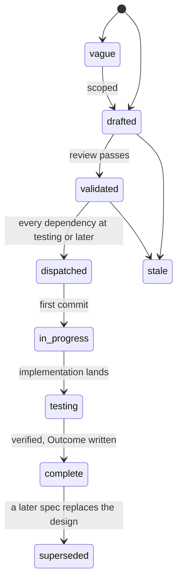

# Specs

Design specs for Limen, the oversight layer for automated actions: a
shared verdict vocabulary, a ledger that measures how often any source
of decisions is wrong, and a predictor that learns when a person needs
to see an action. One spec covers one module. Each spec states the
problem, the design with enough precision to build from, and acceptance
criteria that are testable statements. Spec 001 fixes the architecture
every other spec assumes; read it first. Spec 002 is the Go contract a
decision point codes against and spec 003 the same contract over HTTP;
spec 008 is the ledger's estimation arithmetic, and spec 006 the suite
that proves an implementation serves all three. Spec 004 is the engine
that predicts, spec 005 the adapters that put Limen behind a harness's
decision point, and spec 007 the evidence each step of a rollout must
produce before the next one starts.

The design follows the research in Changkun Ou, *Learning When to Ask:
Trust Calibration for Agentic Tool Use, from Known Tools to Opaque LLM
Judges*, [arXiv:2605.19151](https://arxiv.org/abs/2605.19151). Its
simulation, its Python reference implementation, its Lean 4 proofs, and a
Go port of the gateway are at
[github.com/changkun/trustcalib](https://github.com/changkun/trustcalib);
a spec that cites a proposition cites that paper.

Specs 001 and 002 describe code that exists; every other spec describes
code that is being built.

## Layout

Flat files `specs/NNN-name.md` in one number space with `track: core` in
the frontmatter. Numbers are stable identifiers and are never reused. Open
specs sit here and are the work queue. A terminal spec moves to
`specs/.archive/` keeping its number so `depends_on` paths keep resolving.

## Lifecycle

`in_progress` is written `in-progress` in the frontmatter. A spec at
`testing` moves to `complete` when every acceptance criterion has a
passing test in the tree and the Outcome records every divergence.

The dispatch gate is on the dependencies' state, not on `complete`: a
validated spec is dispatched when every spec in its `depends_on` is at
`testing` or later.

## Index

| Spec | Title | Status |
|---|---|---|
| [001](001-architecture.md) | Architecture: the shared vocabulary, the ledger, the predictor, and the decision point that composes them | drafted |
| [002](002-contract.md) | Contract: the Go types, the Predictor, Ledger and Admin interfaces, the error table, fail-closed | drafted |
| [003](003-http-api.md) | HTTP API: routes, bodies, statuses, the authorizer action and resource fields per route, subject binding, limits | drafted |
| [004](004-engine.md) | Engine: the time axis, the open-set featurizer, the additive GP-probit, fitting off the hot path, versions, the store | drafted |
| [005](005-adapters.md) | Adapters: decision points for Claude Code and Codex hooks, Topos, and any harness over HTTP | drafted |
| [006](006-conformance.md) | Conformance suite and stub: the invariants every limen.Service holds, and an in-memory service for decision points' tests | drafted |
| [007](007-evidence-gates.md) | Evidence gates: replay, shadow, learned decisions inside the ceiling, judge signals, and what stops a rollout | drafted |
| [008](008-ledger-and-estimation.md) | Ledger and estimation: the records, the derived roles of answers, and the error rate of any decision source | drafted |

The order of building is the order of the numbers except where a spec's
`depends_on` says otherwise. 007 is not built; it is the rule every
deployment of the others follows.
