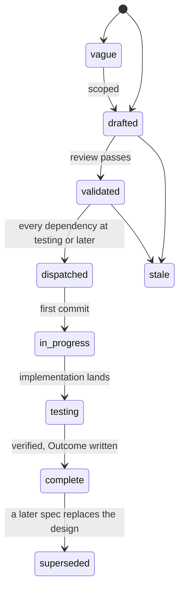

# Specs

Design specs for Limen, the oversight layer for automated actions: a
shared verdict vocabulary, a ledger that measures how often any source
of decisions is wrong, and a predictor that learns when a person needs
to see an action. One spec covers one module. Each spec states the
problem, the design with enough precision to build from, and acceptance
criteria that are testable statements. Spec 001 fixes the architecture
every other spec assumes; read it first. Spec 002 is the Go contract a
decision point codes against and spec 003 the same contract over HTTP;
spec 008 is the ledger's estimation arithmetic, and spec 006 the suite
that proves an implementation serves all three. Spec 004 is the engine
that predicts, spec 005 the adapters that put Limen behind a harness's
decision point, and spec 007 the evidence each step of a rollout must
produce before the next one starts. Spec 009 is the explanations: why
a prediction is what it is, and the evidence behind an `ask`. Spec 010
is what an organization needs: an agent that goes back to the cost
profile of its organization, a cost profile of a person that only makes
the cost profile of the organization stricter, and a weekly report that
never shows one person.

The design follows the research in Changkun Ou, *Learning When to Ask:
Trust Calibration for Agentic Tool Use, from Known Tools to Opaque LLM
Judges*, [arXiv:2605.19151](https://arxiv.org/abs/2605.19151). Its
simulation, its Python reference implementation and its Lean 4 proofs
are at [github.com/changkun/trustcalib](https://github.com/changkun/trustcalib).
The Go port of the gateway, whose kernel and Gaussian-process code the
engine ports, is at that repository's tag
[`v3`](https://github.com/changkun/trustcalib/tree/v3/go) and no longer
on its main branch. A spec that cites a proposition cites that paper.

Limen v0.3.0 is in production since 2026-11-01. Each spec's Outcome
records what is built, the tests that prove it, and what is not built.
Specs 001, 002, 003, 006, 008 and 009 are complete. Spec 004 is at
`testing`: a second model version and a shared store are not built.
Spec 005's hooks are not built, and spec 007 is a rule for
deployments. Spec 010 is at `testing`: it is built, and it moves to
`complete` when its release is in production.

## Layout

Flat files `specs/NNN-name.md` in one number space with `track: core` in
the frontmatter. Numbers are stable identifiers and are never reused. Open
specs sit here and are the work queue. A terminal spec moves to
`specs/.archive/` keeping its number so `depends_on` paths keep resolving.
The spec gate does not read the archive yet (`.lateregate.yaml` has no
`archive` setting), so the complete specs stay here until it does.

## Lifecycle

`in_progress` is written `in-progress` in the frontmatter. A spec at
`testing` moves to `complete` when every acceptance criterion has a
passing test in the tree and the Outcome records every divergence.

A spec's status records its own acceptance criteria. Review, not the
gate, holds the order `depends_on` states: it dispatches a validated
spec once every spec in its `depends_on` is at `testing` or later, not
`complete`.

## Index

| Spec | Title | Status |
|---|---|---|
| [001](001-architecture.md) | Architecture: the shared vocabulary, the ledger, the predictor, and the decision point that composes them | complete |
| [002](002-contract.md) | Contract: the Go types, the Predictor, Ledger and Admin interfaces, the error table, fail-closed | complete |
| [003](003-http-api.md) | HTTP API: routes, bodies, statuses, the authorizer action and resource fields per route, subject binding, limits | complete |
| [004](004-engine.md) | Engine: the time axis, the open-set featurizer, the additive GP-probit, fitting off the hot path, versions, the store | testing |
| [005](005-adapters.md) | Adapters: decision points for Claude Code and Codex hooks, Topos, and any harness over HTTP | drafted |
| [006](006-conformance.md) | Conformance suite and stub: the invariants every limen.Service holds, and an in-memory service for decision points' tests | complete |
| [007](007-evidence-gates.md) | Evidence gates: replay, shadow, learned decisions inside the ceiling, judge signals, and what stops a rollout | drafted |
| [008](008-ledger-and-estimation.md) | Ledger and estimation: the records, the derived roles of answers, and the error rate of any decision source | complete |
| [009](009-explanations.md) | Explanations: why a prediction is what it is, what the model has learned about a person, and what another profile would have done, each exact for the model | complete |
| [010](010-organizations.md) | Organizations: remove a saved cost profile, a stricter cost profile for one person, and a weekly report that never shows one person | testing |

The order of building is the order of the numbers except where a spec's
`depends_on` says otherwise. 007 is not code; it is the rule a
deployment of the others follows, amended on 2026-11-01 for hosted
Topos, where Limen decides only where it has evidence about the person.
